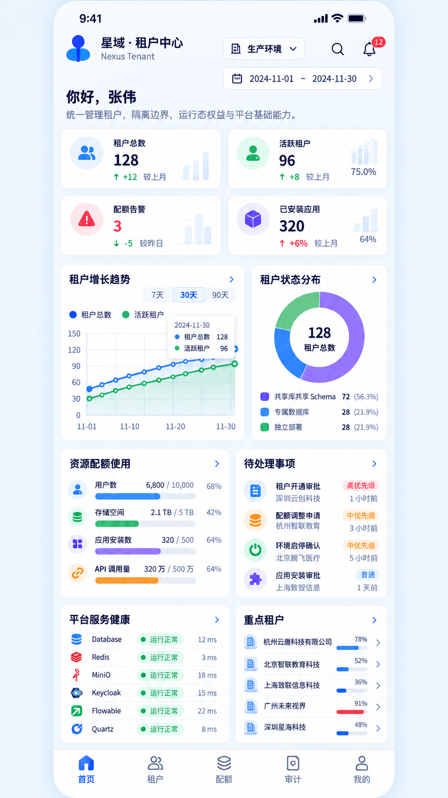
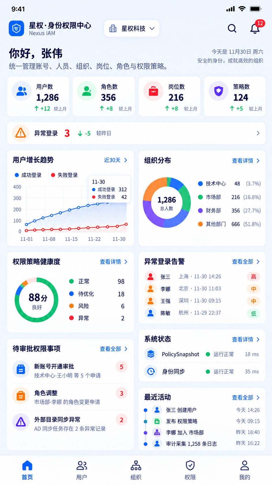
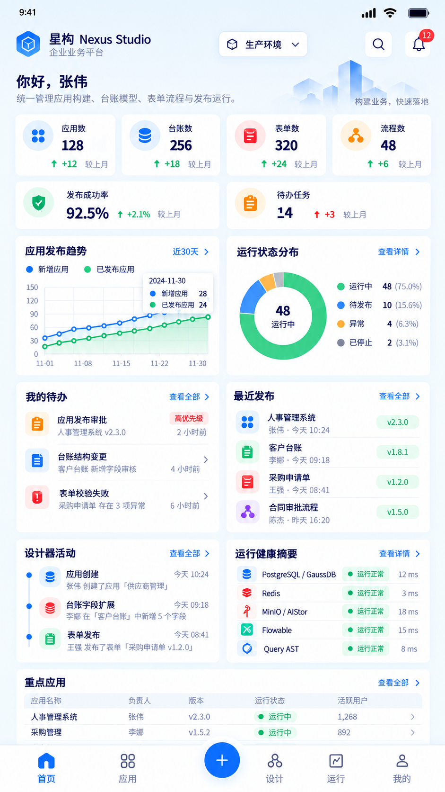
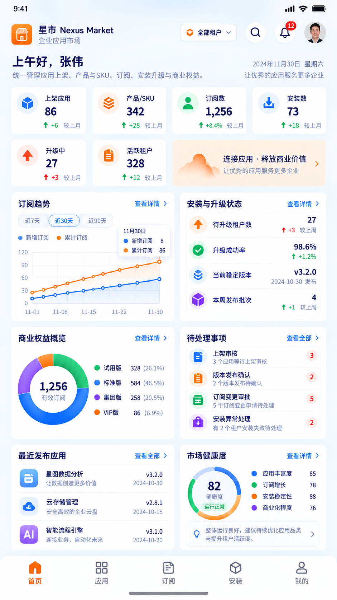
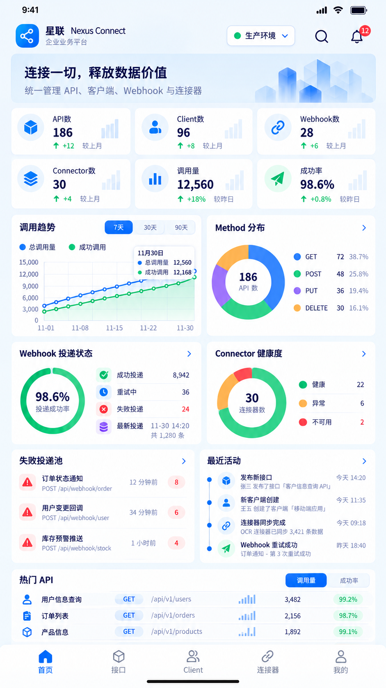
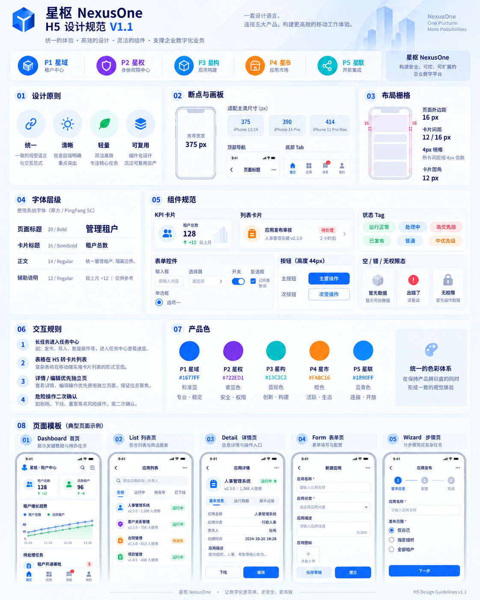

# 星枢 NexusOne H5 页面设计与前端开发规范 V1.1

> **文档状态**：H5 / Mobile Web 统一设计与开发基线 / 确定  
> **适用版本**：需求规格 V1.1、技术框架 V1.1  
> **上位规范**：[星枢 NexusOne WEB 页面设计与前端开发规范 V1.1](./星枢NexusOne_WEB页面设计与前端开发规范_V1.1.md)  
> **视觉基线**：P1 星域、P2 星权、P3 星构、P4 星市、P5 星联五张最新 H5 首页效果图 + H5 设计规范视觉板  
> **适用终端**：移动浏览器、企业 APP WebView、小程序 web-view、企业协同工具内嵌 H5  
> **适用对象**：产品经理、UI/UX、前端开发、后端开发、测试、架构师、代码评审人  
> **核心目标**：确保五个产品在 H5 上拥有统一、清晰、轻量、可复用的移动体验，同时严格继承桌面端 Tenant / Permission / DataScope / FieldPolicy / Audit / Task 等业务与安全规则。

---

# 0. 总则

## 0.1 H5 不是“桌面页面缩小”

NexusOne H5 的基本原则：

> **保留任务，重组信息；保留业务语义，改变信息密度；保留权限边界，不复制桌面布局。**

禁止：

- 把 1440px 页面按比例缩小到 375px；
- 在手机上保留桌面 Sidebar；
- 把 10 列 Table 压缩成 10 列小字；
- 把 Drawer 缩窄后继续当复杂编辑页；
- 依赖 Hover；
- 把桌面 Designer 原样搬到移动端；
- 因为屏幕小而省略安全确认、权限提示、审计提示；
- 在 H5 单独创造一套业务状态。

H5 要解决的是：

1. 快速查看；
2. 快速处理；
3. 快速审批；
4. 快速查询；
5. 移动场景下的少量录入；
6. 任务与异常提醒；
7. 随时进入详细对象；
8. 在移动端完成“应该在移动端完成的工作”。

复杂建模、批量治理、超大表格、完整设计器优先桌面端。

## 0.2 与桌面规范的关系

规则优先级：

```text
需求规格 V1.1 / 技术框架 V1.1
        >
页面设计与前端开发规范 V1.1
        >
本 H5 页面设计与前端开发规范 V1.1
        >
具体产品页面稿
        >
开发者局部实现
```

如果 H5 规范没有覆盖某项：

> 默认继承桌面规范，不允许自行创造新规则。

## 0.3 五产品 H5 视觉定位

| 产品 | H5 产品名 | 产品色 | 底部核心导航 | 首页视觉关键词 |
|---|---|---|---|---|
| P1 | 星域·租户中心 / Nexus Tenant | 蓝 | 首页 / 租户 / 配额 / 审计 / 我的 | 稳定、治理、租户健康 |
| P2 | 星权·身份权限中心 / Nexus IAM | 紫蓝 | 首页 / 用户 / 组织 / 权限 / 我的 | 身份、安全、组织与权限 |
| P3 | 星构 / Nexus Studio | 蓝 + 青绿 | 首页 / 应用 / 主操作 / 设计 / 运行 / 我的 | 构建、发布、待办、运行 |
| P4 | 星市 / Nexus Market | 橙 + 蓝 | 首页 / 应用 / 订阅 / 安装 / 我的 | 应用交付、订阅、升级 |
| P5 | 星联 / Nexus Connect | 蓝 + 青 | 首页 / 接口 / Client / 连接器 / 我的 | API、Webhook、连接状态 |

P3 的中央“+”属于 **Floating Primary Action**，不计算为普通 Tab。

---

# 1. H5 视觉参考基线

V1.1 H5 视觉母版，文件在 [references/h5](./references/h5)：













五张 H5 首页共同确定：

- 顶部产品 App Bar；
- 当前环境 / 租户选择；
- 搜索与通知入口；
- 2～4 列移动 KPI 卡；
- 卡片式趋势、构成、任务、健康列表；
- 白卡 + 浅蓝灰页面背景；
- 底部 Tab Bar；
- 大触控区域；
- 独立页面代替复杂 Drawer；
- 移动端列表卡片代替桌面宽表。

**首页母版只定义视觉语言和信息密度，不代表所有子页面都必须使用 Dashboard 布局。**

---

# 2. H5 Design Token

H5 与桌面端共享基础 Token，但允许定义 Mobile Alias。

## 2.1 基础颜色

继承桌面端：

```css
:root {
  --nx-bg-page: #F5F8FC;
  --nx-bg-sidebar: #F8FAFD;
  --nx-surface: #FFFFFF;
  --nx-surface-hover: #F8FAFF;

  --nx-text-primary: #102A56;
  --nx-text-regular: #40536D;
  --nx-text-secondary: #74839A;
  --nx-text-disabled: #AAB5C4;

  --nx-border: #E5EBF3;
  --nx-border-strong: #D5DEEA;
  --nx-divider: #EDF1F6;

  --nx-primary: #246BFD;
  --nx-success: #12B76A;
  --nx-warning: #F79009;
  --nx-danger: #F04438;
  --nx-info: #2E90FA;
}
```

## 2.2 产品色

```css
[data-product="p1"] { --nx-product: #1677FF; }
[data-product="p2"] { --nx-product: #722ED1; }
[data-product="p3"] { --nx-product: #1677FF; --nx-product-secondary: #13C2C2; }
[data-product="p4"] { --nx-product: #FA8C16; }
[data-product="p5"] { --nx-product: #1890FF; --nx-product-secondary: #13C2C2; }
```

规则：

- 产品色 = 品牌识别；
- 状态色 = 业务状态；
- 不得把 P4 橙色同时当“警告”而不区分语义；
- Danger 永远使用统一红色；
- Success 永远使用统一绿色。

## 2.3 H5 字体层级

优先系统字体：

```css
font-family:
  -apple-system,
  BlinkMacSystemFont,
  "PingFang SC",
  "Microsoft YaHei",
  "Noto Sans CJK SC",
  Arial,
  sans-serif;
```

| 场景 | 字号 | 字重 | 行高 |
|---|---:|---:|---:|
| Hero问候/关键标题 | 24px | 700 | 34px |
| 页面标题 | 20px | 700 | 30px |
| Card标题 | 16px | 600 | 24px |
| 列表主文案 | 15px | 500/600 | 22px |
| 正文 | 14px | 400 | 22px |
| 表单输入值 | **16px** | 400 | 24px |
| 辅助说明 | 12px | 400 | 18px |
| Tag | 11–12px | 500 | 18px |
| KPI核心数值 | 24–28px | 700 | 34px |
| 超大关键数值 | 30–32px | 700 | 40px |

### 输入框为什么使用 16px

H5 输入框字体统一不低于 16px：

- 保证可读；
- 避免移动浏览器输入聚焦时异常放大；
- 统一表单体验。

## 2.4 H5 间距

采用 4px Grid：

```text
4 / 8 / 12 / 16 / 20 / 24 / 32
```

标准：

| 场景 | 值 |
|---|---:|
| 页面左右边距 | 16px |
| 页面区块垂直间距 | 16px |
| Card之间 | 12px |
| Card内边距 | 16px |
| 列表行上下 Padding | 12px |
| Icon与文字 | 8px |
| Label与输入框 | 8px |
| Form项之间 | 20px |
| 底部操作区按钮间距 | 12px |

禁止非必要使用：

```text
13px
15px
17px
19px
23px
```

## 2.5 H5 圆角

```text
6px   Input / Button
8px   Tag / 小卡片
12px  标准 Card / Bottom Sheet
16px  Hero / 大型 KPI / 首页核心面板
20px  特殊营销/产品 Banner（少用）
```

## 2.6 阴影

H5 要比桌面更轻：

```css
--nx-mobile-shadow-card:
  0 4px 16px rgba(31, 56, 88, .05);

--nx-mobile-shadow-floating:
  0 8px 28px rgba(31, 56, 88, .14);

--nx-mobile-shadow-bottom:
  0 -8px 24px rgba(31, 56, 88, .08);
```

不要给每个列表项加阴影。

---

# 3. 画板、Viewport 与 Safe Area

## 3.1 推荐设计宽度

视觉基线以：

```text
375px
```

作为主设计宽度。

必须验证：

```text
360px
375px
390px
414px
```

Tablet/H5 还需验证：

```text
768px
```

## 3.2 页面最大宽度

普通手机：

```css
width: 100%;
```

Tablet 或桌面浏览器打开移动模式：

```css
max-width: 768px;
margin: 0 auto;
```

不要把 H5 内容无限拉伸。

## 3.3 Safe Area

必须使用：

```css
padding-top: env(safe-area-inset-top);
padding-bottom: env(safe-area-inset-bottom);
```

底部 Tab / Sticky CTA：

```css
padding-bottom:
  calc(8px + env(safe-area-inset-bottom));
```

禁止写死：

```css
padding-bottom: 34px;
```

## 3.4 视口高度

不要直接依赖：

```css
height: 100vh;
```

优先：

```css
min-height: 100dvh;
```

并为旧 WebView 提供回退。

---

# 4. H5 全局页面框架

标准结构：

```text
+------------------------------+
| Status / Safe Area           |
+------------------------------+
| Mobile App Bar               |
+------------------------------+
| Optional Hero / Page Header  |
+------------------------------+
| Scrollable Content           |
|                              |
|                              |
+------------------------------+
| Sticky Action（可选）        |
+------------------------------+
| Bottom Tab Bar（一级页）     |
| Safe Area                    |
+------------------------------+
```

## 4.1 一级页面

有 Bottom Tab。

例如：

```text
首页
租户
配额
审计
我的
```

## 4.2 二级页面

通常隐藏 Bottom Tab，保留：

```text
Back
Page Title
More
```

## 4.3 三级页面

尽量避免层级过深。

移动端最大推荐：

```text
一级 Tab
  → 列表
    → 详情
      → 编辑
```

超过 4 级应重新设计信息架构。

---

# 5. Mobile App Bar

## 5.1 首页 App Bar

由：

```text
Logo / 产品名
Tenant / Environment Selector
Search
Notification
Avatar（可选）
```

组成。

高度建议：

```text
56px
```

加 Safe Area 后实际视觉高度由设备决定。

## 5.2 子页面 App Bar

```text
[Back] 页面标题                 [...]
```

规则：

- Back触控区域至少 44×44；
- 标题超长单行省略；
- More最多进入 Action Sheet；
- 不在 Header 放 4 个以上 Icon。

## 5.3 Hero Header

五张 H5 首页均有较明显的产品首屏信息：

```text
你好，张伟
统一管理……
```

或：

```text
连接一切，释放数据价值
```

子页面不需要 Hero。

---

# 6. Tenant / Environment Selector

## 6.1 首页

以 Pill 展示：

```text
生产环境 ▼
星权科技 ▼
全部租户 ▼
```

## 6.2 点击行为

少于 8 项：

> Bottom Sheet。

多于 8 项：

> 全屏 Picker + Search。

## 6.3 安全规则

Tenant ID 不能由前端 Selector 自己决定安全边界。

Selector 只表示：

> 用户请求切换上下文。

后端重新验证：

- 用户是否有租户权限；
- 是否允许 PlatformContext；
- 是否允许当前环境。

---

# 7. Bottom Tab Bar

## 7.1 规格

高度：

```text
56px + safe-area-bottom
```

Icon：

```text
22–24px
```

Label：

```text
11–12px
```

最多：

```text
5 个普通 Tab
```

P3 允许：

```text
4–5 Tab + 中央 FAB
```

## 7.2 状态

```text
Active
Inactive
Badge
Disabled（极少）
```

Active：

- 产品色；
- Icon + Label 同时高亮。

## 7.3 不允许

- Tab 超过 5 个；
- 横向滚动 Tab Bar；
- 把所有桌面 Sidebar 菜单搬到底部；
- 一级导航用文字缩写导致含义不清。

---

# 8. Floating Action Button

仅用于真正的高频主动作。

P3 示例：

```text
+
```

点击：

```text
新建应用
新建台账
创建表单
发起流程
```

可用 Action Sheet 承载。

规格：

```text
56px
```

触控：

```text
>= 56×56
```

禁用：

- 每个产品都强行放 FAB；
- 同时存在 FAB + Sticky Primary CTA 争夺主操作。

---

# 9. 首页 KPI 规范

五张图共同采用了紧凑 KPI Card。

## 9.1 布局

375px：

```text
2列
```

允许极简场景：

```text
4个迷你KPI横向网格
```

但每个 KPI 必须保证：

- 名称可读；
- 数字完整；
- 趋势不挤压。

## 9.2 内容

KPI Card 最多：

```text
Icon
Name
Value
Trend
Optional mini visual
```

禁止：

- 一张 KPI Card 放 3 个不同指标；
- 核心值被进度图遮挡；
- 趋势颜色与业务状态冲突。

## 9.3 KPI 点击

有对应详情时整卡可点击。

必须提供：

- Press态；
- `aria-label`；
- 不依赖右上角 12px 小链接。

---

# 10. H5 Dashboard 首页模板

推荐顺序：

```text
App Bar
Hero
KPI Grid
Primary Trend
Distribution / Health
Todo
Recent Activity
Core Entity List
Bottom Tab
```

## 10.1 信息优先级

H5 首页一屏内优先：

1. 今天要处理什么；
2. 系统有没有异常；
3. 核心指标怎么样；
4. 主要对象能否快速进入。

不是优先展示所有统计图。

## 10.2 卡片顺序可按角色调整

例如：

- 租户管理员：Todo优先；
- 平台运维：Health优先；
- 审批人员：My Task优先；
- 运营人员：Trend优先。

但视觉组件不变化。

---

# 11. H5 Card

统一：

```text
NxMobileCard
NxMobileStatCard
NxMobileChartCard
NxMobileListCard
NxMobileHealthCard
NxMobileActionCard
```

默认：

```text
background: #FFF
radius: 12px
padding: 16px
border: 1px solid var(--nx-border)
```

首页允许轻阴影。

普通列表页优先使用：

```text
border + flat surface
```

避免“卡片套卡片套卡片”。

---

# 12. 列表卡片代替桌面 Table

## 12.1 转换规则

桌面：

```text
| 应用名称 | 负责人 | 版本 | 状态 | 活跃用户 | 操作 |
```

H5：

```text
人事管理系统                  运行中
v2.3.0
负责人：张伟
活跃用户：1,268
最近发布：今天 10:24             >
```

## 12.2 Card字段优先级

每张移动列表卡最多：

- 1 个主标题；
- 1 个 Status；
- 2～4 个 Metadata；
- 1 个辅助时间；
- 1 个进入箭头。

多余字段放 Detail。

## 12.3 操作

整卡：

> 进入详情。

快速操作：

> More Action Sheet。

不要一行放：

```text
编辑 删除 停用 重置 更多
```

---

# 13. H5 Search

## 13.1 搜索入口

一级页面可：

- App Bar Icon；
- 页面顶部 Search Bar。

## 13.2 Search Page

点击 Search 后进入全屏搜索页：

```text
[Back] [搜索输入              ]
最近搜索
推荐
搜索结果
```

## 13.3 结果

按对象分组：

```text
租户
用户
应用
API
```

结果必须严格服从后端权限。

## 13.4 键盘

Search Input：

```text
enterkeyhint="search"
```

---

# 14. H5 Filter

桌面 FilterBar 转换为：

```text
[搜索] [筛选]
```

## 14.1 常用筛选

可以用顶部 Chips：

```text
全部
运行中
待发布
异常
```

最多 4～5 个。

## 14.2 复杂筛选

进入 Bottom Sheet / Full-screen Filter。

结构：

```text
筛选
状态
类型
时间
组织
负责人
---------
重置         确定
```

## 14.3 Filter状态

筛选后按钮显示 Badge：

```text
筛选 3
```

---

# 15. H5 Pagination / Infinite List

移动端默认不显示传统：

```text
1 2 3 4 5
```

优先：

```text
Infinite Load
```

或：

```text
加载更多
```

接口仍采用稳定分页契约。

必须处理：

```text
Initial
Loading
LoadingMore
NoMore
Error
Retry
```

搜索结果发生 Filter 变化时：

- 清空旧页；
- 回第一页；
- 回到列表顶部。

---

# 16. Pull to Refresh

只有符合移动习惯的列表/首页可启用。

适合：

- 首页；
- Task；
- Activity；
- API Logs；
- Tenant List。

不适合：

- Form；
- Designer；
- Wizard；
- 长详情页编辑状态。

刷新必须：

- 保留当前 Tenant；
- 保留 Filter；
- 不重置用户输入。

---

# 17. Detail 详情页模板

标准 H5 Detail：

```text
App Bar
Status Summary
Primary Information
Section Cards
Activity / Audit
Sticky Action（可选）
```

## 17.1 不使用桌面 Tab 的情况

少于 4 个 Section：

> 纵向分组。

## 17.2 使用 Tab 的情况

复杂详情：

```text
概览
配置
记录
```

使用 Sticky Segmented Tabs。

Tab不能超过 4 个。

---

# 18. Form 页面规范

## 18.1 单列

H5 Form 一律单列。

禁止双列表单。

## 18.2 输入高度

```text
44–48px
```

Textarea：

```text
96–144px
```

## 18.3 Label

H5 优先 Top Label：

```text
应用名称 *
[请输入应用名称]
```

## 18.4 Sticky Footer

创建/编辑页面：

```text
取消 / 保存
```

或：

```text
保存草稿 / 提交
```

Footer固定底部，并处理 Safe Area。

## 18.5 键盘遮挡

输入聚焦时：

- 自动 scrollIntoView；
- Sticky Footer 可上移或隐藏；
- 不让键盘遮住正在输入字段。

---

# 19. Mobile Picker

以下不使用桌面 Dropdown：

- 用户；
- 部门；
- 岗位；
- 角色；
- 租户；
- API Scope；
- 大量 SKU。

统一 Picker 页面：

```text
标题
搜索
最近/已选
列表
底部确认
```

## 19.1 多选

必须显示：

```text
已选 5
```

允许：

```text
查看已选
清空
```

---

# 20. Bottom Sheet

适合：

- Filter；
- Quick Action；
- 少量选择；
- 简短说明；
- Confirmation扩展。

高度：

```text
Auto
50%
75%
```

超过 75%：

> 使用全屏页面。

不能在 Bottom Sheet 塞复杂长表单。

---

# 21. Dialog / Alert

移动端 Dialog 只处理：

- 简短确认；
- 重要提示；
- 危险操作。

按钮：

```text
取消
确认
```

最多 2 个主按钮。

复杂操作改独立页面。

---

# 22. Action Sheet

适合列表的 More：

```text
编辑
停用
复制链接
查看审计
----------------
删除
```

Danger永远放最后，并用红色。

---

# 23. Wizard 步骤页

复杂移动任务使用 Wizard。

示例：

```text
1 基本信息
2 配置
3 确认
```

H5：

- 顶部简化 Stepper；
- 一步只解决一个任务；
- 底部固定 CTA；
- 每步可返回；
- 已填写信息不丢失；
- 高风险提交最后一步再次确认。

---

# 24. 移动端 Tree / 组织结构

不直接使用桌面两栏 Tree。

H5 改为 Drill-down：

```text
集团
  >
技术中心
  >
研发一部
```

页面：

```text
[Back] 组织架构
[搜索部门]
当前路径：集团 / 技术中心
--------------------------------
研发一部                86人 >
研发二部                62人 >
产品部                  24人 >
```

需要成员时进入下一页。

---

# 25. H5 Designer 策略

这是必须冻结的移动端边界。

## 25.1 不做完整设计器

H5 不提供：

- 完整 BPMN 拖拽；
- 复杂表单设计器；
- Schema大规模字段设计；
- 页面布局设计；
- 图形化规则编排。

这些保持 Desktop First。

## 25.2 H5 “设计”入口允许

P3 底部“设计”可以展示：

```text
草稿列表
待校验
最近设计
发布审批
设计器活动
Preview
```

以及少量 Quick Edit：

```text
修改名称
修改说明
启停简单字段
修改基础文案
```

## 25.3 进入复杂编辑

显示：

```text
该功能建议在桌面端完成
[查看详情]
[复制桌面链接]
```

---

# 26. H5 Chart 规范

## 26.1 一张 Card 一个核心图

禁止在 375px Card 内左右放两张复杂图。

## 26.2 Line Chart

建议：

- 高度 180–220px；
- 2条主要曲线；
- 最多3条；
- x轴只显示 4～5 个 Tick；
- Tap 显示 Tooltip；
- 不依赖 Hover。

## 26.3 Donut

建议：

- 3～5分类；
- 中心核心值；
- Legend放下方或右侧短布局；
- 分类过多改 List/Bar。

## 26.4 Scroll Chart

时间跨度太长时：

- 使用时间段切换；
- 不用水平拖动看 100 个点作为默认交互。

## 26.5 图表无障碍

Card底部提供简短文字：

```text
近30天租户数由96增长至128。
```

---

# 27. H5 Progress / Quota

P1 资源配额、P4升级进度等使用：

```text
Icon
名称                 68%
6,800 / 10,000
[==========------]
```

颜色：

```text
0–79%  Product / Normal
80–89% Warning
>=90%  Danger
```

具体业务阈值如由后端提供，则以前端后端契约为准。

---

# 28. Timeline / Activity

移动 Timeline：

```text
dot  动作
     操作者 · 对象
     时间
```

最多首页显示 4～5 条。

详情页可以无限加载。

---

# 29. Todo / Approval Card

移动端 Todo 是高优先组件。

结构：

```text
Icon
任务标题                  Priority
对象 / 申请人
时间                          >
```

快速审批是否允许，按业务风险决定。

默认：

> 先进入详情，再同意/驳回。

不要在首页卡片上直接出现“同意/拒绝”两个危险按钮。

---

# 30. Health Card

移动首页健康卡只显示：

```text
Service
Status
Latency
```

例如：

```text
Redis           正常    3 ms
Flowable        正常   15 ms
```

不在 H5 首页展示：

- Heap；
- GC；
- Thread Pool；
- SQL TopN；
- 大型 Trace瀑布。

专业运维详情留 Desktop。

---

# 31. Status Tag

统一：

```text
Success  正常/运行中/已发布
Info     处理中/同步中
Warning  待处理/待升级
Danger   失败/异常/高风险
Neutral  草稿/未配置/已停止
```

H5 Tag：

```text
height 22–24px
padding 0 8px
```

---

# 32. Toast / Snackbar

## 32.1 Success

短操作：

```text
保存成功
```

2～3秒消失。

## 32.2 Error

短错误：

```text
保存失败，请重试
Trace ID: xxxx
```

允许复制 Trace ID。

## 32.3 长任务

不能 Toast：

```text
发布中……
```

十几秒不消失。

超过长任务阈值进入 Task Center。

---

# 33. Loading

## 33.1 首屏

Skeleton。

## 33.2 KPI

数字 Skeleton 保留卡片高度。

## 33.3 List

显示 3～5 行 Skeleton。

## 33.4 Chart

保留 Chart Card，内部 Skeleton。

禁止整个页面只放一个大 Spinner。

---

# 34. Empty / Error / NoPermission / Offline

必须分别设计：

## EMPTY

```text
暂无应用
创建第一个应用后，可开始构建业务。
[新建应用]
```

## ERROR

```text
加载失败
Trace ID: xxxx
[重新加载]
```

## NO_PERMISSION

```text
无查看权限
如需访问，请联系管理员。
```

## OFFLINE

```text
网络不可用
请检查网络后重试。
```

禁止全部使用：

```text
暂无数据
```

---

# 35. 弱网设计

H5 必须考虑：

- 地铁/电梯；
- WebView断网；
- Wi-Fi/4G切换；
- 请求超时；
- 页面切后台后恢复。

规则：

1. GET 失败可 Retry；
2. Mutation 不自动无脑重试；
3. 有 Idempotency Key 才允许安全重试写操作；
4. 提交中切后台后重新进入要查询最终状态；
5. 长任务以 Task ID 恢复；
6. 不在前端“猜提交成功”。

---

# 36. 页面返回规则

## 36.1 Browser Back

必须可用。

## 36.2 Unsaved Form

返回前：

```text
当前修改尚未保存，是否离开？
```

## 36.3 Wizard

Back：

- 回上一步；
- 第一步再返回才退出。

## 36.4 Deep Link

直接打开 Detail 后 Back：

- 有历史 → history.back；
- 无历史 → 返回产品默认列表/首页。

---

# 37. URL 与 Route 状态

H5 仍然保持可分享和可恢复。

URL保存：

```text
keyword
status
filter
tab
page cursor（需要时）
entity id
```

不把：

```text
tenant permission
secret
token
```

写进 URL。

---

# 38. 移动端文件上传

统一 `NxMobileUpload`。

支持：

- 文件选择；
- 图片选择；
- 相机入口（宿主允许时）；
- 进度；
- 取消；
- 失败重试；
- 文件大小/MIME提示。

前端不直连 MinIO / AIStor 私有管理 API。

上传流程：

```text
H5
→ File Service
→ Authorize
→ Upload / Presigned
→ File ID
```

---

# 39. 移动端文件预览

支持类型由产品能力决定。

统一页面：

```text
文件名
类型
大小
上传人
时间

[预览区域]

下载
```

敏感文件：

- 禁止未授权缓存；
- 下载前再次验证；
- 预览失败给明确原因。

---

# 40. 相机 / 扫码 / 定位等宿主能力

V1.1 默认 H5 不依赖原生能力完成核心业务。

如果某项目需要：

```text
Camera
QR Scan
Location
Share
Clipboard
```

必须通过：

```text
HostBridgePort
```

能力检测：

```text
supported / unsupported
```

没有 Host 能力时必须有 Web fallback 或明确提示。

---

# 41. H5 Authentication / Session

H5 复用 NexusOne 统一认证体系。

前端禁止：

- 自己实现密码登录逻辑；
- 自己签 Token；
- 长期敏感 Token 明文 LocalStorage；
- URL携带 Access Token。

必须处理：

```text
Session Expired
Login Redirect
Tenant Changed
Account Disabled
Permission Changed
```

Session过期：

> 跳统一登录，并保留安全的 Return URL。

---

# 42. 权限 UI

完全继承桌面规范。

## 42.1 Route Permission

无权限不展示入口。

## 42.2 Action Permission

```text
Hidden
Disabled + Reason
```

## 42.3 FieldPolicy

后端返回：

```text
visible
editable
masked
```

H5严格执行。

## 42.4 DataScope

H5不计算 DataScope。

列表/图表数量均以后端授权结果为准。

---

# 43. Tenant Context

App Bar 必须在需要时展示当前 Tenant/Scope。

PlatformContext：

```text
平台视图
```

必须明显，不与普通租户页面混淆。

跨租户动作：

- 二次确认；
- 显示作用范围；
- 后端验证；
- 审计。

---

# 44. Audit

H5 审计页偏“查看”。

Card：

```text
Action
Actor
Resource
Result
Occurred At
Trace ID
```

Detail 不默认展示敏感 Payload。

不允许编辑/删除审计记录。

---

# 45. Task Center

移动端长任务统一进入 Task Center。

Card：

```text
应用发布
RUNNING
62%
提交人 张伟
开始 10:24
```

操作：

```text
查看
重试（有权限）
取消（可取消时）
```

状态：

```text
QUEUED
RUNNING
SUCCESS
FAILED
CANCELLED
```

---

# 46. 通知中心

顶部 Bell Badge。

通知分：

```text
业务通知
任务通知
系统通知
异常通知
```

支持：

- 已读；
- 全部已读；
- 点击直达业务对象。

Push / 宿主通知不是首期 UI 必须条件。

---

# 47. P1 星域 H5 首页规范

严格参考 P1 最新 H5 图。

## 47.1 App Bar

```text
星域·租户中心
Nexus Tenant

生产环境 ▼
Search
Notification
```

## 47.2 KPI

优先：

```text
租户总数
活跃租户
配额告警
已安装应用
```

## 47.3 内容

顺序建议：

```text
租户增长趋势
租户状态/隔离分布
资源配额使用
待处理事项
平台服务健康
重点租户
```

## 47.4 Bottom Tabs

```text
首页
租户
配额
审计
我的
```

---

# 48. P1 星域 H5 子页面

## 48.1 租户列表

Card：

```text
杭州云唐科技                       正常
tenant: hz-yuntang
管理员：张伟
用户：680 / 1000
应用：32
最近活动：1小时前                    >
```

Filter：

```text
状态
配额
创建时间
```

## 48.2 租户详情

Section：

```text
状态摘要
基础信息
管理员
配额
已安装应用
租户关系
最近审计
```

复杂租户配置优先 Desktop。

## 48.3 配额

移动端重点：

```text
用户
存储
应用安装
API调用
自建台账
```

每项：

```text
当前值 / 上限 / 百分比 / 告警
```

## 48.4 审计

Card List + Search + Filter。

## 48.5 租户关系

使用 Drill-down List，不用 Desktop Tree。

---

# 49. P2 星权 H5 首页规范

参考 P2 最新 H5 图。

## 49.1 KPI

```text
用户数
角色数
岗位数
策略数
异常登录
```

## 49.2 首页区块

```text
用户/登录趋势
组织分布
权限策略健康度
异常登录告警
待审批权限事项
PolicySnapshot/同步状态
最近活动
```

## 49.3 Bottom Tabs

```text
首页
用户
组织
权限
我的
```

---

# 50. P2 星权 H5 子页面

## 50.1 用户列表

Card：

```text
张三                         正常
技术中心 / 高级工程师
角色：研发人员、项目管理员
最近登录：今天 14:26            >
```

## 50.2 用户详情

```text
账号
人员
任职
角色
权限摘要
登录状态
最近审计
```

## 50.3 组织

Drill-down。

## 50.4 岗位/任职

列表分组：

```text
部门
  岗位
    人员
```

## 50.5 角色授权

H5 不展示巨大 Permission Matrix。

移动端：

```text
角色详情
已授权资源组
关键操作
DataScope摘要
```

完整矩阵编辑 Desktop First。

## 50.6 DataScope

移动端允许选择标准模板：

```text
本人
本部门
本部门及下级
指定部门
Owner
```

复杂条件编辑建议 Desktop。

## 50.7 FieldPolicy

移动端适合查看和少量调整。

大量字段矩阵 Desktop First。

---

# 51. P3 星构 H5 首页规范

参考 P3 最新 H5 图。

## 51.1 KPI

```text
应用数
台账数
表单数
流程数
发布成功率
待办任务
```

## 51.2 区块

```text
应用发布趋势
运行状态分布
我的待办
最近发布
设计器活动
运行健康摘要
重点应用
```

## 51.3 Bottom

```text
首页
应用
[+]
设计
运行
我的
```

中央 `+` 为 Floating Action。

---

# 52. P3 星构 H5 子页面

## 52.1 应用列表

Card：

```text
人事管理系统                   运行中
v2.3.0
负责人 张伟
台账 6 · 表单 12 · 流程 4
活跃用户 1,268                   >
```

## 52.2 应用详情

```text
概览
版本
运行
发布记录
```

## 52.3 业务台账运行页

这是 H5 重点。

桌面 Table → H5 Record Card。

例如：

```text
采购申请 PR-20260922-001        审批中
申请人：张三
部门：采购部
金额：¥ 12,500
提交：今天 10:24                 >
```

## 52.4 业务 Record Detail

```text
状态
基础字段
关联对象
流程状态
附件
操作记录
```

FieldPolicy 控制字段。

## 52.5 Record Form

移动录入：

- 单列；
- 分 Section；
- 长表单可折叠；
- Picker 全屏；
- 附件使用 Mobile Upload；
- Sticky Save/Submit。

## 52.6 我的待办

Card优先显示：

```text
流程名称
业务单号
申请人
关键金额/对象
到达时间
优先级
```

## 52.7 审批详情

底部 Sticky Action：

```text
驳回
同意
```

需要更多：

```text
更多
→ 转办 / 委派 / 撤回...
```

高风险流程必须确认。

## 52.8 设计

只做：

```text
Draft
Recent Design
Validation
Publish Approval
Preview
```

完整设计器 Desktop First。

---

# 53. P4 星市 H5 首页规范

参考 P4 最新 H5 图。

## 53.1 KPI

```text
上架应用
Product/SKU
订阅数
安装数
升级中
活跃租户
```

## 53.2 区块

```text
订阅趋势
安装与升级状态
商业权益概览
待处理事项
最近发布应用
市场健康度
```

## 53.3 Bottom Tabs

```text
首页
应用
订阅
安装
我的
```

---

# 54. P4 星市 H5 子页面

## 54.1 应用目录

2列 Card Grid 或单列 Rich Card。

375px 推荐：

```text
1列 Rich Card
```

## 54.2 应用详情

```text
简介
当前版本
SKU
订阅
安装范围
发布记录
```

## 54.3 Product / SKU

H5 默认浏览优先。

复杂 SKU 创建/权益组合 Desktop First。

## 54.4 Subscription

Card：

```text
星权科技
企业版 SKU-ENT-01               生效中
开始：2026-09-01
到期：2027-08-31
安装：v3.2.0                      >
```

## 54.5 安装升级

移动端非常适合：

```text
查看状态
批准升级
查看失败
触发重试
```

不适合大量 Schema 配置编辑。

## 54.6 Upgrade Detail

明确展示：

```text
Current Version
Target Version
Precheck
Schema Expand
Data Migrate
Switch
Verify
```

并显示：

> 版本回退不会回滚共享物理 Schema 或已有业务数据。

---

# 55. P5 星联 H5 首页规范

参考 P5 最新 H5 图。

## 55.1 KPI

```text
API数
Client数
Webhook数
Connector数
调用量
成功率
```

## 55.2 区块

```text
调用趋势
Method分布
Webhook投递状态
Connector健康度
失败投递池
最近活动
热门API
```

## 55.3 Bottom Tabs

```text
首页
接口
Client
连接器
我的
```

---

# 56. P5 星联 H5 子页面

## 56.1 API List

Card：

```text
GET
用户信息查询
/api/v1/users
v1 · Published
今日 3,482 · 成功 99.2%            >
```

## 56.2 API Detail

```text
Overview
Request
Response
Scope
Example
Change Log
```

代码示例使用可横向滚动 Code Block。

## 56.3 Client

Card：

```text
移动端应用                         正常
Scopes: user.read, order.read
今日调用 2,150
最后调用 11:35                     >
```

不显示 Client Secret。

## 56.4 Webhook

```text
订单状态通知
POST https://...
成功率 98.6%
失败 8
最近 14:20                         >
```

## 56.5 Failure Pool

失败列表适合移动端快速处理：

```text
查看错误
重试
进入业务对象
```

批量重放建议 Desktop。

## 56.6 Connector

Card：

```text
ERP Connector                     健康
类型 REST
最后同步 今天 09:18
3,421 条
```

复杂 Mapping Editor Desktop First。

---

# 57. Desktop → H5 映射规则

| Desktop | H5 |
|---|---|
| Sidebar | Bottom Tabs + More/Menu |
| Global Header | Mobile App Bar |
| 6 KPI横排 | 2列/紧凑网格 |
| 3列 Dashboard | 单列或2列轻量 Card |
| Table | Entity Card List |
| FilterBar | Search + Filter Sheet |
| Pagination | Infinite / Load More |
| Drawer | Full Page / Bottom Sheet |
| Dialog大表单 | Independent Form Page |
| Tree + Detail | Drill-down |
| Permission Matrix | Summary + Desktop Edit |
| BPMN/Form Designer | Preview/Quick Action |
| Hover Tooltip | Tap Tooltip |
| Context Menu | Action Sheet |
| Keyboard Shortcut | Search/Icon/Action |
| Dense Audit Table | Audit Card List |
| Side Detail Panel | Detail Page |

---

# 58. H5 功能支持等级

每个功能设计前标记：

```text
M-FULL
M-LIMITED
DESKTOP-FIRST
NOT-SUPPORTED
```

定义：

## M-FULL

移动端完整支持。

例：

```text
待办审批
查看租户
查看应用
查看API
通知
```

## M-LIMITED

移动端完成常用操作，复杂配置去 Desktop。

例：

```text
角色授权
DataScope
SKU配置
Connector配置
```

## DESKTOP-FIRST

移动端只查看/跳转提示。

例：

```text
BPMN Designer
复杂表单 Designer
大型 Permission Matrix
大规模数据导入
```

## NOT-SUPPORTED

明确不提供。

---

# 59. H5 路由结构

建议：

```text
/m/p1/home
/m/p1/tenants
/m/p1/tenants/:id

/m/p2/home
/m/p2/users
/m/p2/org

/m/p3/home
/m/p3/apps
/m/p3/apps/:id
/m/p3/tasks
/m/p3/runtime/:app/:ledger/:id

/m/p4/home
/m/p4/apps
/m/p4/subscriptions

/m/p5/home
/m/p5/apis
/m/p5/clients
/m/p5/connectors
```

不要与 Desktop Route 混成大量条件判断的一个组件。

共享 ViewModel 可复用，页面布局分开。

---

# 60. H5 前端工程结构

建议：

```text
src/
├─ app/
├─ design-system/
│  ├─ tokens/
│  ├─ desktop/
│  └─ mobile/
├─ shared/
│  ├─ api/
│  ├─ auth/
│  ├─ tenant/
│  ├─ permission/
│  ├─ file/
│  ├─ task/
│  └─ host-bridge/
├─ desktop/
│  └─ products/
├─ mobile/
│  ├─ layouts/
│  ├─ components/
│  └─ products/
│     ├─ p1-tenant/
│     ├─ p2-iam/
│     ├─ p3-studio/
│     ├─ p4-market/
│     └─ p5-connect/
└─ domain/
```

原则：

> Domain / API / Permission 共享，Desktop 与 H5 View/Layout 分离。

---

# 61. H5 页面目录

```text
mobile/products/p3-studio/apps/
├─ pages/
│  ├─ AppListPage.vue
│  ├─ AppDetailPage.vue
│  └─ AppQuickCreatePage.vue
├─ components/
│  ├─ AppCard.vue
│  └─ AppStatus.vue
├─ composables/
├─ view-model/
└─ route.ts
```

---

# 62. H5 公共组件最低清单

```text
NxMobileShell
NxMobileAppBar
NxMobilePageHeader
NxBottomTabs
NxSafeArea
NxHeroBanner

NxMobileCard
NxMobileStatCard
NxMobileChartCard
NxEntityCard
NxTodoCard
NxActivityCard
NxHealthCard
NxQuotaRow

NxMobileSearch
NxFilterTrigger
NxFilterSheet
NxSegmentedControl
NxStatusTag

NxMobileForm
NxMobileFormSection
NxMobileInput
NxMobileTextarea
NxMobilePicker
NxMobileDatePicker
NxMobileSwitch
NxMobileRadio
NxMobileCheckbox

NxBottomSheet
NxActionSheet
NxConfirmDialog
NxStickyActionBar
NxFAB

NxPullRefresh
NxInfiniteList
NxSkeleton
NxEmpty
NxError
NxNoPermission
NxOffline

NxMobileUpload
NxFileCard
NxTaskCard
NxAuditCard

NxUserPicker
NxOrgPicker
NxPositionPicker
NxRolePicker
NxTenantPicker
```

---

# 63. 禁止个人重复实现

每个开发者禁止自己写另一套：

- Bottom Tab；
- App Bar；
- Bottom Sheet；
- Filter Sheet；
- Toast；
- StatusTag；
- Empty；
- Error；
- NoPermission；
- Infinite Scroll；
- Pull Refresh；
- Form Input；
- Picker；
- Sticky Footer；
- Upload；
- Permission Action；
- Task Progress。

第二次出现相同模式就必须进入公共组件评审。

---

# 64. Vue H5 规范

统一：

```vue
<script setup lang="ts">
```

要求：

- TypeScript；
- 不使用 `any`；
- Props/Emits强类型；
- 页面不直接 fetch；
- API DTO 与 Mobile ViewModel 分开；
- 触控状态必须有 active/pressed；
- 不依赖 hover；
- 组件卸载取消无效请求；
- 页面切后台需要可恢复状态。

---

# 65. API 调用

结构：

```text
Mobile Page
   ↓
Composable / UseCase
   ↓
Product API
   ↓
Shared HTTP Client
```

API Error：

```ts
interface ApiError {
  code: string
  message: string
  traceId: string
  retryable?: boolean
  details?: unknown
}
```

---

# 66. 移动 ViewModel

不要让桌面 Table DTO 直接控制移动页面。

例如桌面：

```ts
TenantRowDTO
```

移动：

```ts
interface TenantCardVM {
  id: string
  title: string
  code: string
  status: StatusVM
  adminName: string
  quotaUsage: number
  lastActivityText: string
  canOpen: boolean
}
```

API数据可共享，ViewModel单独映射。

---

# 67. 移动端状态管理

页面状态分：

```text
Server State
Route State
UI State
Draft State
Host State
```

不要全部放一个 Global Store。

例如：

- Tenant：Global/Context；
- Filter：Route；
- BottomSheet Open：Local；
- API Data：Server Cache；
- Form Draft：Page/Form State。

---

# 68. 表单草稿

普通表单：

- 优先服务端 Draft；
- 页面内临时状态保存在 Memory。

禁止敏感业务字段长期放：

```text
localStorage
```

如果确实要离线草稿，必须专项设计加密、过期和清理规则。

---

# 69. 触控规范

最小触控目标：

```text
44 × 44px
```

图标视觉可以 20px，但点击区域必须至少 44px。

相邻危险按钮间距：

```text
>= 8px
```

不依赖精准小图标操作。

---

# 70. 手势规范

允许：

- Tap；
- Vertical Scroll；
- Pull Refresh；
- 可选 Swipe Back（宿主/浏览器能力）。

谨慎：

- Swipe Delete；
- Swipe Action；
- Long Press。

原因：

> 企业业务不能把高风险动作藏在不可发现手势里。

删除绝不只靠 Swipe。

---

# 71. 横屏

普通业务 H5：

> 不以横屏作为主要体验。

横屏可改善：

- Chart；
- 文件预览；
- 少量报表。

Designer仍不因横屏就变成 Desktop Designer。

---

# 72. 移动端 Accessibility

最低要求：

- Touch Target ≥44px；
- 文本对比 ≥4.5:1；
- Icon Button有 aria-label；
- 状态不只靠颜色；
- Form Error关联输入；
- Screen Reader顺序符合视觉顺序；
- Dynamic Toast用 aria-live；
- Bottom Tab有当前选中状态；
- Chart有文字摘要。

---

# 73. 国际化

与 Desktop 共用 Key。

H5必须处理：

- 中文文本更短；
- English可能更长；
- Button不能固定窄宽；
- Status Tag允许自适应。

禁止为了中文效果把容器写死。

---

# 74. 文案

H5 文案要更短。

Desktop：

```text
统一管理租户、隔离边界、运行态权益与平台基础能力
```

H5仍可作为首页副标题。

但列表操作不要：

```text
点击此处查看当前租户的详细信息
```

改：

```text
查看详情
```

---

# 75. 日期与数字

首页可：

```text
今天 14:26
昨天 18:40
```

详情：

```text
2026-09-22 14:26
```

大数字：

```text
12,560
320万
2.1TB
```

不要一个页面混乱使用：

```text
12560 / 12.56k / 1.256万
```

---

# 76. 移动端性能工程目标

作为工程基线：

## 首屏

目标：

```text
LCP <= 2.5s（典型移动网络目标）
```

## JS

- Route Level Split；
- 非首屏模块 Lazy Load；
- Chart库按需；
- Designer代码绝不进入普通 H5 首页 Bundle。

## 图片

优先：

```text
SVG Icon
WebP/AVIF（内容图）
```

## Dashboard

只加载首屏核心数据。

下方 Card：

> IntersectionObserver进入视区再请求。

---

# 77. Chart 性能

- 页面同时活动 ECharts实例建议 <= 4；
- 离屏图表 Dispose / Suspend；
- Resize Debounce；
- 数据点过多先后端聚合；
- 不在手机渲染数万点。

---

# 78. List 性能

小列表：

```text
Normal DOM
```

数百以上：

- 分页；
- Infinite；
- 必要时 Virtual List。

不能一次把 5000 个用户塞到 H5 DOM。

---

# 79. 请求并发

Dashboard多个 Card 不允许无控制发 20 个 API。

建议：

- Dashboard Aggregate API；
或
- 受控并发；
- 相同请求去重。

用户切 Tenant 时取消旧 Context 请求。

---

# 80. Embedded WebView

必须测试：

```text
Safari
Chrome Android
APP WebView
小程序 web-view（如果交付）
企业协同宿主 WebView（如果交付）
```

## 80.1 重复 Header

如果宿主自带 Title Bar：

H5可通过 Host Context 切换：

```text
embedded=true
```

隐藏重复 App Bar 的一部分。

## 80.2 Host能力

所有宿主差异放：

```text
HostBridgePort
```

业务页面不判断：

```ts
if (isWeChat) ...
if (isDingTalk) ...
```

---

# 81. Mobile 安全规范

前端不能：

- 自信任 tenant_id；
- 本地生成权限；
- LocalStorage持久化 Secret；
- 显示完整 Credential；
- 把 Access Token写 URL；
- 直接访问 Keycloak Admin；
- 直接访问 Flowable Admin；
- 直接访问 MinIO管理 API；
- 在错误弹窗暴露堆栈、SQL或内部路径。

---

# 82. 防重复提交

移动网络更容易重复点击。

所有 Mutation Button：

- 点击立即 Disable；
- 显示 Pending；
- 请求携带 Idempotency Key（适用接口）；
- 切后台恢复后查询最终结果。

不能靠前端 Disable 作为唯一幂等保证。

---

# 83. 危险操作

必须：

```text
Action
Impact
Object
Scope
Confirm
```

例如：

```text
停用租户

停用后该租户用户将无法继续访问业务系统。

租户：杭州云唐科技

取消    确认停用
```

删除、撤销发布、Credential Revoke 等需要 Danger UI。

---

# 84. H5 开发个人工作流

每一个 H5 页面都必须执行。

## Step 1 需求确认

写清：

```text
Product
Module
Page
Mobile Support Level
User
Goal
Tenant Scope
Permission
DataScope
FieldPolicy
Primary Action
Long Task?
Desktop Equivalent?
```

## Step 2 选择移动模板

只能优先从：

```text
Mobile Dashboard
Card List
Detail
Form
Wizard
Drill-down
Task
Audit
Settings
```

选择。

## Step 3 做 Desktop → H5 信息裁剪

明确：

```text
桌面字段
保留字段
移到详情字段
H5不支持字段/操作
```

## Step 4 组公共组件

不先写 CSS。

## Step 5 完整状态

实现：

```text
Loading
Success
Empty
Error
NoPermission
Offline
LoadingMore
NoMore
```

## Step 6 权限

检查：

```text
Route
Action
FieldPolicy
DataScope
Tenant
PlatformContext
```

## Step 7 设备检查

至少：

```text
360
375
390
414
768
```

## Step 8 弱网

模拟：

- Slow 4G；
- Offline；
- Timeout；
- Duplicate Click；
- Background/Resume。

## Step 9 PR

必须附：

- 375截图；
- 390或414截图；
- Requirement ID；
- Mobile Support Level；
- Desktop对应页；
- Route；
- Permission；
- 弱网结果；
- 是否新增Mobile Component。

---

# 85. H5 PR Review 强制清单

Reviewer 必查：

- [ ] 是否遵循 H5 视觉母版；
- [ ] 是否使用 MobileShell；
- [ ] 是否处理 Safe Area；
- [ ] 是否正确使用 Bottom Tab；
- [ ] 二级页是否正确隐藏 Tab；
- [ ] Touch Target 是否 >=44px；
- [ ] 输入框是否 >=16px；
- [ ] 是否没有 Hover-only 功能；
- [ ] Desktop Table 是否已正确转 Card；
- [ ] Filter 是否移动到 Sheet；
- [ ] 复杂操作是否独立页面；
- [ ] Designer 是否超出 Mobile Scope；
- [ ] 是否有 Loading；
- [ ] Empty；
- [ ] Error；
- [ ] NoPermission；
- [ ] Offline；
- [ ] LoadingMore / NoMore；
- [ ] 是否处理 Tenant；
- [ ] Action Permission；
- [ ] FieldPolicy；
- [ ] DataScope 不在前端计算；
- [ ] Mutation 防重复；
- [ ] 长任务进入 Task Center；
- [ ] 危险动作二次确认；
- [ ] Error包含 Trace ID；
- [ ] 不保存 Secret；
- [ ] 不直连第三方 Admin API；
- [ ] 没有硬编码颜色/间距；
- [ ] 360/375/390/414无溢出；
- [ ] 键盘不遮挡输入；
- [ ] Bottom Safe Area正常；
- [ ] Browser Back正常；
- [ ] Deep Link正常；
- [ ] 弱网恢复正常；
- [ ] 截图回归通过。

---

# 86. UI/UX 责任

H5 UI/UX 必须负责：

- Mobile Information Architecture；
- Desktop → Mobile降维；
- Token；
- Mobile Component；
- Touch；
- Safe Area；
- Keyboard；
- Bottom Sheet；
- Responsive；
- Empty/Error；
- H5视觉稿。

不负责：

- 自定义DataScope；
- 自创权限；
- 自定义Tenant规则。

---

# 87. 前端责任

负责：

- Mobile Shell；
- 路由；
- Shared Mobile Components；
- Permission UI；
- Tenant Context；
- ViewModel；
- API状态；
- Weak Network；
- Safe Area；
- WebView兼容；
- Accessibility；
- 性能。

不得：

- 为了移动端“方便”跳过业务安全规则；
- 把桌面组件复制一份改 `width: 100%` 就算 H5；
- 每个人做一套 Bottom Sheet。

---

# 88. 后端责任

H5 API必须提供：

- 分页 / Cursor；
- 精简移动 DTO 或可映射 DTO；
- Permission；
- DataScope过滤结果；
- FieldPolicy；
- Error Code；
- Trace ID；
- Task ID；
- Idempotency；
- Tenant安全；
- Dashboard Aggregate（需要时）。

---

# 89. QA 责任

H5 QA 不只测 Happy Path。

必须覆盖：

```text
小屏
大屏
Safe Area
旋转
弱网
断网
恢复
重复点击
Session过期
Tenant切换
NoPermission
Field Mask
长任务
文件上传失败
浏览器返回
WebView返回
键盘遮挡
```

---

# 90. H5 页面 Owner

每个移动页面唯一 Owner。

Issue Metadata：

```text
Platform: H5
Product: P3
Module: Task
Page: MyTodoList
Owner: xxx
Designer: xxx
Backend: xxx
QA: xxx
Requirement: P3-...
MobileLevel: M-FULL
DesktopPage: ...
```

---

# 91. M0 H5 范围

H5 M0 不要求覆盖所有 M0 桌面建模能力。

## P1

```text
H5首页简版
租户列表
租户详情
配额查看
基础审计
```

## P2

```text
H5首页简版
用户列表/详情
组织浏览
岗位任职查看
角色/权限摘要
```

## P3

重点是 Runtime：

```text
应用列表
业务记录列表
业务记录详情
业务表单录入
我的待办
审批详情
已办
我发起
站内通知
```

M0 H5 不要求：

```text
完整表单设计器
完整BPMN设计器
复杂Schema设计
```

---

# 92. 五产品 H5 一致性验收

用户在：

```text
星域
→ 星权
→ 星构
→ 星市
→ 星联
```

之间切换时，以下必须一致：

- App Bar；
- Back；
- Search；
- Notification；
- Bottom Tab风格；
- Card；
- Form；
- Status；
- Filter；
- Bottom Sheet；
- Sticky CTA；
- Empty；
- Error；
- Offline；
- Permission；
- Upload；
- Task；
- Audit；
- Trace ID。

产品差异只来自：

- 产品色；
- 业务对象；
- 首页指标；
- Bottom Tab语义；
- 产品专属交互。

---

# 93. H5 视觉回归

建议建立固定截图：

```text
360x800
375x812
390x844
414x896
768x1024
```

每个核心页面至少：

```text
Default
Loading
Empty
Error
NoPermission
Long Text
```

PR自动比较截图差异。

---

# 94. 长文本/极端数据测试

必须测试：

```text
租户名称 40字
用户姓名 20字
应用名称 50字
Tag超长
金额 999,999,999,999.99
数字 99,999,999
0数据
负增长
100%使用率
999+通知
```

规则：

- Title可省略；
- 核心金额不省略；
- 999+ Badge；
- 关键 ID 提供 Copy。

---

# 95. H5 开发 Do / Don't

## Do

- 以375为主画板；
- 使用Safe Area；
- 使用44px触控目标；
- Table转Card；
- Filter用Bottom Sheet；
- 复杂编辑用独立页面；
- 长任务进Task Center；
- 弱网可恢复；
- Query/Permission由后端控制；
- 先完成运行场景，再做管理复杂场景。

## Don't

- 不把桌面页面缩放；
- 不使用Hover；
- 不做10列表格；
- 不让用户点12px小图标；
- 不在Bottom Sheet做50字段表单；
- 不在H5做完整BPMN Designer；
- 不在H5保存Secret；
- 不把Token放URL；
- 不前端计算DataScope；
- 不把每个产品做成不同移动App风格。

---

# 96. H5 页面 Definition of Done

一个 H5 页面只有同时满足以下条件才算完成：

1. 符合五张 H5 视觉母版；
2. 与 Desktop 同一业务语义；
3. Mobile Support Level 已标记；
4. 使用统一 MobileShell；
5. App Bar正确；
6. Bottom Tab / Back正确；
7. Safe Area正确；
8. 360px不横向溢出；
9. 375/390/414布局正确；
10. Touch Target >=44px；
11. Form Input >=16px；
12. Loading完成；
13. Empty完成；
14. Error完成；
15. NoPermission完成；
16. Offline完成；
17. LoadingMore/NoMore完成；
18. Tenant安全正确；
19. Permission正确；
20. DataScope正确；
21. FieldPolicy正确；
22. 长任务使用Task Center；
23. Mutation防重复；
24. 危险动作确认；
25. 文件通过File Service；
26. 无第三方Admin直连；
27. Trace ID可见；
28. Browser Back正确；
29. Deep Link正确；
30. 键盘不遮挡；
31. WebView目标环境测试；
32. Accessibility基础通过；
33. 国际化无严重溢出；
34. 性能目标通过；
35. 无硬编码设计值；
36. 无重复公共组件；
37. 单测/组件测试通过；
38. 视觉回归通过；
39. QA弱网场景通过；
40. 提供最终截图。

---

# 97. H5 页面设计交付物

每个页面设计交付至少包含：

```text
Default
Loading
Empty
Error
NoPermission
Filter Open
Action Sheet
Danger Confirm
Long Text
```

Form另外包含：

```text
Validation Error
Keyboard Open
Submitting
Submit Success
```

List另外包含：

```text
Loading More
No More
Filter Applied
```

---

# 98. 推荐后续工程产物

规范冻结后建议继续形成：

```text
1. NexusOne Mobile Design Tokens
2. NxMobile Components Catalog
3. H5 Storybook / Component Preview
4. P1–P5 H5 Sitemap
5. Desktop→H5 Capability Matrix
6. M0 H5 Backlog
7. Safe Area / WebView Test Harness
8. Mobile Visual Regression
9. Weak Network E2E Suite
10. Mobile Page Generator / Scaffold
```

---

# 99. 最终原则

NexusOne H5 的目标不是：

> “让手机也能打开桌面后台。”

而是：

> **让企业用户在移动场景中，以统一、安全、快速、可理解的方式完成最需要移动处理的工作。**

最终要求：

```text
同一套领域
同一套权限
同一套状态
同一套设计语言
不同的信息密度
不同的交互组织
```

所有开发者只需要：

1. 选择正确 H5 页面模板；
2. 使用统一 Mobile Component；
3. 使用正确业务数据；
4. 遵守 Tenant / Permission / Task / Audit 契约；

就能开发出属于同一个 **星枢 NexusOne** 的移动页面。
