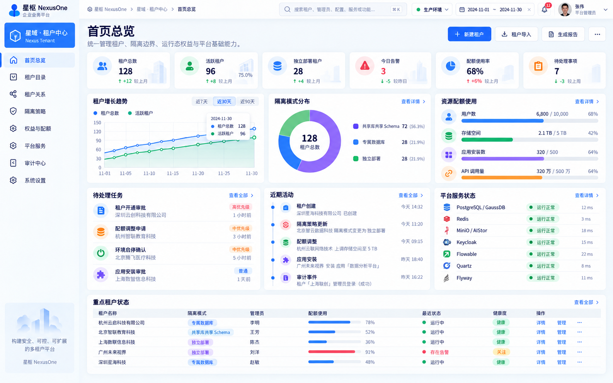
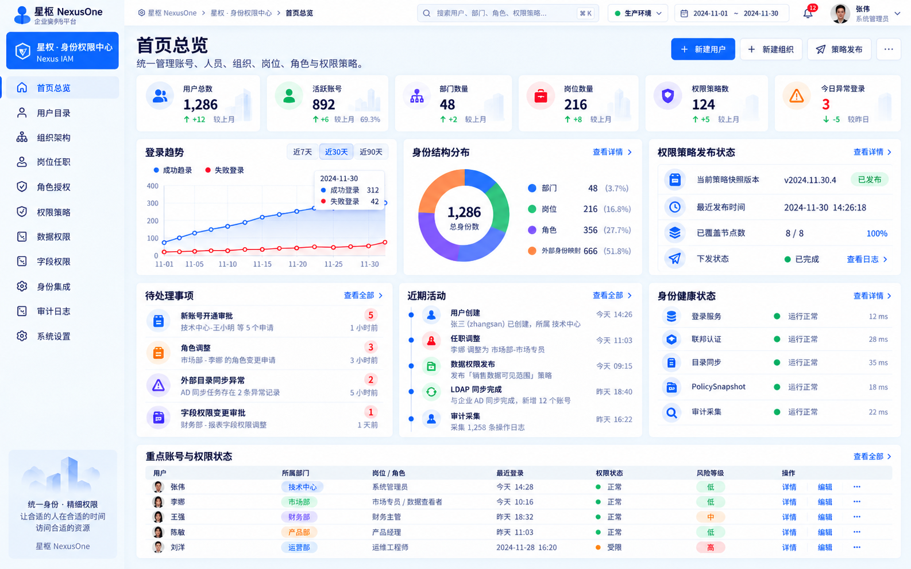
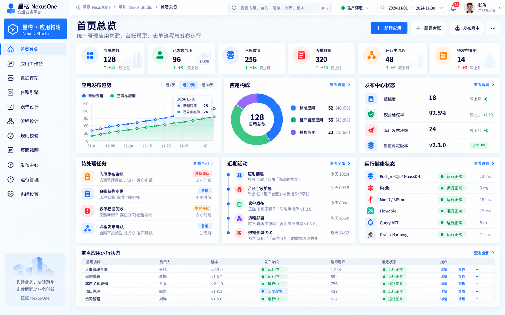
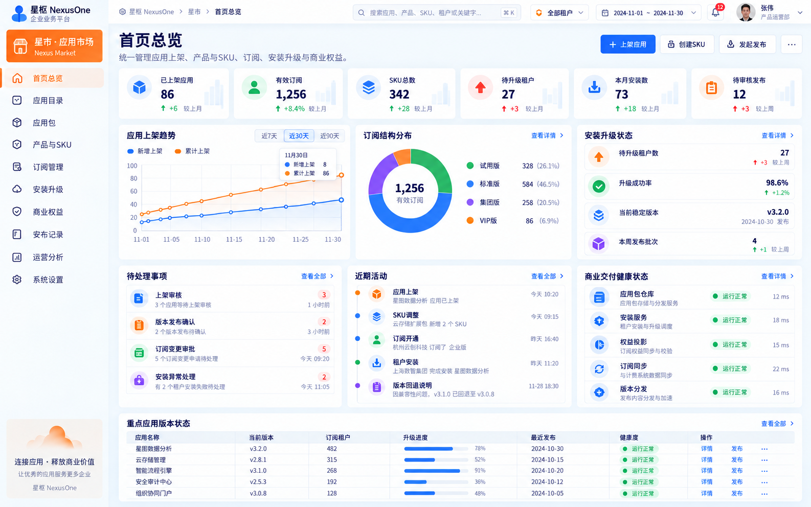
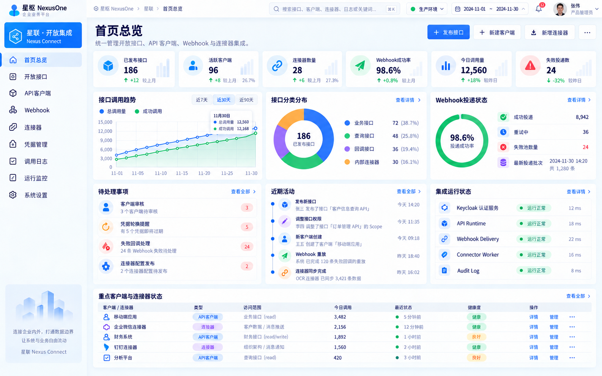

# 星枢 NexusOne WEB页面设计与前端开发规范 V1.1

> **文档状态**：前端与UI统一开发基线 / 确定  
> **适用版本**：需求规格 V1.1、技术框架 V1.1  
> **视觉基线**：P1 星域、P2 星权、P3 星构、P4 星市、P5 星联五张最新首页效果图  
> **适用对象**：产品经理、UI/UX、前端开发、后端开发、测试、架构师、代码评审人  
> **核心目标**：保证五个产品、所有子页面、所有开发人员输出的界面在视觉、交互、信息架构、权限、安全、代码结构与验收标准上保持一致。

---

# 0. 总则

## 0.1 本规范解决的问题

本规范不是单纯的“UI颜色规范”，而是 NexusOne 的页面实现合同，解决：

1. 五个产品视觉必须属于同一平台家族；
2. 子页面不能每个开发者各自设计；
3. 相同业务场景必须使用相同页面模板；
4. 同一组件在不同产品中不能出现五种交互；
5. 页面不能绕过 Tenant / Permission / DataScope / FieldPolicy；
6. Loading、Empty、Error、Disabled、NoPermission 等状态必须统一；
7. 前端不能直接绑定 Keycloak、Flowable、MinIO/AIStor 等第三方内部接口；
8. 页面设计必须能从桌面 Web 平滑降级到 H5；
9. 所有页面必须可测试、可维护、可复用、可审查。

## 0.2 五个产品视觉定位

| 产品 | 中文名 | 英文名 | 主色 | 视觉性格 |
|---|---|---|---|---|
| P1 | 星域·租户中心 | Nexus Tenant | 蓝 | 稳定、治理、平台控制 |
| P2 | 星权·身份权限中心 | Nexus IAM | 紫蓝 | 权限、安全、组织治理 |
| P3 | 星构 | Nexus Studio | 蓝 + 青绿 | 构建、设计、运行 |
| P4 | 星市 | Nexus Market | 橙 + 蓝 | 交付、商业化、运营 |
| P5 | 星联 | Nexus Connect | 蓝 + 青 | 开放、连接、调用 |

五个产品：

- **允许主色不同**；
- **不允许布局体系不同**；
- **不允许字号、卡片、表格、表单、弹窗、空状态各自设计**；
- 产品差异只体现在：
  - 产品主色；
  - 产品图标；
  - 业务文案；
  - 首页指标；
  - 产品专属页面。

---

# 1. 视觉参考基线

以下 5 张图片是 V1.1 页面设计的首页视觉参考，文件在 [references/web](./references/web)：











子页面设计时必须继承：

- 左侧产品导航；
- 顶部全局导航；
- 页面 Header；
- 白色卡片 + 浅灰背景；
- 统一边框、阴影、圆角；
- 统一表格和状态标签；
- 统一操作按钮层级；
- 统一图表和数据密度；
- 统一页边距和栅格。

首页效果图是“视觉母版”，**不是要求所有子页面都做成 Dashboard**。

---

# 2. Design Token 设计令牌

所有页面禁止硬编码零散颜色、间距、圆角。必须使用 Design Token。

## 2.1 全局颜色

```css
:root {
  --nx-bg-page: #F5F8FC;
  --nx-bg-sidebar: #F8FAFD;
  --nx-surface: #FFFFFF;
  --nx-surface-hover: #F8FAFF;

  --nx-text-primary: #102A56;
  --nx-text-regular: #40536D;
  --nx-text-secondary: #74839A;
  --nx-text-disabled: #AAB5C4;

  --nx-border: #E5EBF3;
  --nx-border-strong: #D5DEEA;
  --nx-divider: #EDF1F6;

  --nx-primary: #246BFD;
  --nx-primary-hover: #1D5DE0;
  --nx-primary-light: #EEF5FF;

  --nx-success: #12B76A;
  --nx-success-light: #EAFBF3;
  --nx-warning: #F79009;
  --nx-warning-light: #FFF6E8;
  --nx-danger: #F04438;
  --nx-danger-light: #FFF0EF;
  --nx-info: #2E90FA;
  --nx-info-light: #EEF6FF;

  --nx-chart-blue: #2E78FF;
  --nx-chart-green: #20B26B;
  --nx-chart-purple: #7A5AF8;
  --nx-chart-orange: #FF8A34;
  --nx-chart-red: #F04438;
  --nx-chart-cyan: #16BFD6;
}
```

## 2.2 产品主色

```css
[data-product="p1"] { --nx-product: #246BFD; }
[data-product="p2"] { --nx-product: #6D5CF6; }
[data-product="p3"] { --nx-product: #2475FF; --nx-product-secondary: #13A77A; }
[data-product="p4"] { --nx-product: #FF7A1A; }
[data-product="p5"] { --nx-product: #1687FF; --nx-product-secondary: #18AFC8; }
```

规则：

- 主按钮可使用 `--nx-product`；
- 链接、焦点、高亮默认使用 `--nx-primary`；
- 状态颜色永远使用 success/warning/danger/info，不允许拿产品色表达状态；
- 红色只表达危险、失败、删除、告警；
- 绿色只表达成功、健康、正常；
- 橙色只表达警告/关注，P4 作为产品色时必须避免与警告状态混淆。

## 2.3 字体

首选系统字体，不要求额外下载字体：

```css
font-family:
  Inter,
  "PingFang SC",
  "Microsoft YaHei",
  "Noto Sans CJK SC",
  Arial,
  sans-serif;
```

字号：

| 场景 | 字号 | 字重 | 行高 |
|---|---:|---:|---:|
| 页面主标题 | 28px | 700 | 40px |
| 页面副标题 | 14px | 400 | 22px |
| Card标题 | 16px | 600 | 24px |
| Section标题 | 18px | 600 | 28px |
| 正文 | 14px | 400 | 22px |
| 表格 | 13px/14px | 400 | 20px |
| 辅助说明 | 12px | 400 | 18px |
| KPI数值 | 24–30px | 700 | 36px |
| Badge/Tag | 12px | 500 | 18px |

禁止：

- 页面正文 < 12px；
- 为了“塞更多内容”把表格压到 10px；
- 同一层级出现三种不同字号。

## 2.4 间距

采用 4px 基础单位：

```text
4 / 8 / 12 / 16 / 20 / 24 / 32 / 40 / 48
```

默认：

- 页面外边距：24px；
- Card间距：16px；
- Card内边距：20px；
- Header与主体：20px；
- 表单项垂直间距：20px；
- 按钮间距：8px；
- 表格工具栏与表格：12px。

禁止任意使用 `13px / 17px / 23px` 这类非 Token 间距。

## 2.5 圆角

```text
4px   小标签/小控件
6px   输入框/按钮
8px   普通弹层/内嵌区域
12px  卡片
16px  大型展示卡片/首页核心面板
```

## 2.6 阴影

默认 Card 不使用重阴影：

```css
--nx-shadow-card: 0 4px 16px rgba(31, 56, 88, .06);
--nx-shadow-popover: 0 10px 32px rgba(31, 56, 88, .14);
--nx-shadow-dialog: 0 20px 60px rgba(15, 38, 72, .22);
```

---

# 3. 全局页面框架

## 3.1 Desktop 页面结构

```text
+---------------------------------------------------------------+
| Sidebar 200 | TopHeader 56                                  |
|             +-----------------------------------------------+
|             | Page Header                                   |
|             |                                               |
|             | Main Content                                  |
|             |                                               |
+---------------------------------------------------------------+
```

标准：

- 左导航展开宽度：200px；
- 收起宽度：64px；
- 顶部导航高度：56px；
- 页面内容区外边距：24px；
- 推荐桌面设计宽度：1440–1920；
- 视觉母版约 1586×992；
- 小于 1280 时优先压缩 Card，不随意缩小字号。

## 3.2 栅格

使用 12 列栅格：

- gutter：16px；
- 首页 KPI：
  - ≥1440：6 × 2列；
  - 1200–1439：3 × 4列或 6 等宽；
  - <1200：2–3列换行；
- 普通业务页：
  - 主区 8–9列；
  - 辅助区 3–4列；
- 详情页：
  - 主信息 8列；
  - 状态/操作 4列。

## 3.3 页面滚动

默认：

- Sidebar固定；
- TopHeader固定；
- 主内容纵向滚动；
- 表格长页面不允许整个浏览器横向滚动；
- 表格内部可横向滚动；
- Designer 类页面允许主体高度 `calc(100vh - header)`。

---

# 4. 顶部全局 Header

所有产品共用一个 GlobalHeader。

从左至右：

1. Breadcrumb；
2. Global Search；
3. 环境；
4. 日期范围（仅有意义页面显示）；
5. Notification；
6. User Menu。

## 4.1 Global Search

宽度：

- ≥1440：320–420px；
- 小屏：240px；
- H5隐藏为搜索图标。

支持：

- `⌘K / Ctrl+K`；
- 最近搜索；
- 按产品分组；
- 不允许前端跨权限展示搜索结果。

## 4.2 环境

必须明确：

```text
生产环境
测试环境
开发环境
```

生产环境：

- 绿色状态点；
- 危险动作二次确认。

## 4.3 用户菜单

包含：

- 当前用户；
- 当前租户；
- 当前岗位/主要角色；
- 切换租户（有权限时）；
- 个人设置；
- 退出登录。

---

# 5. 左侧导航

## 5.1 产品头部

固定结构：

```text
[产品Icon] 产品中文名
           Product English Name
```

高度 68–76px。

## 5.2 菜单

单项：

- 高度 42–44px；
- 左 Icon 20px；
- 文字 14px；
- Active 背景用产品主色浅色；
- Active 左侧可有 3px 指示条；
- Hover 不使用重阴影。

## 5.3 导航层级

原则：

- Sidebar 最多 2 层；
- 超过 2 层的功能进入页面内二级导航；
- 一级菜单不超过 11 个；
- 不因为后端 Module 多就全部塞进 Sidebar。

---

# 6. 页面 Header 规范

所有子页面统一：

```text
Breadcrumb（可选）
页面标题                         主操作按钮
页面说明                         次操作 / More
```

例：

```text
租户目录                  [+ 新建租户]
管理平台全部租户及状态     [批量导入] [...]
```

规则：

- 主操作最多 1 个；
- 次操作最多 2 个直接展示；
- 其他操作放 `...`；
- 删除、停用、重置等危险操作不允许成为默认主按钮。

---

# 7. Dashboard 首页模板

五张最新首页统一采用：

## 7.1 第一层：KPI

6 个 KPI Card。

每张只展示：

- Icon；
- 指标名称；
- 核心值；
- 一个趋势；
- 可选一个比例。

禁止：

- 在 KPI Card 塞两张图；
- 同时出现 3 个辅助数字；
- 使用不可解释的百分比。

## 7.2 第二层：趋势 + 构成 + 状态

标准布局：

```text
[趋势图 4列] [构成图 4列] [状态/资源 4列]
```

## 7.3 第三层：待办 + 活动 + 健康

标准布局：

```text
[待处理 4列] [近期活动 4列] [运行健康 4列]
```

## 7.4 第四层：重点对象表格

全宽 Table：

- 5–8行；
- 不分页；
- “查看全部”进入正式列表页；
- 不在首页执行复杂编辑。

---

# 8. Card 组件规范

统一组件：

```text
NxCard
NxPanelCard
NxStatCard
NxHealthCard
NxActivityCard
NxTodoCard
```

Card Header：

```text
标题                    查看全部 / 更多
辅助说明
```

默认：

- padding 20px；
- radius 12px；
- border `--nx-border`；
- 首页可使用轻阴影；
- 业务列表页面优先 border，不堆阴影。

禁止：

- 同页面同时出现 8/12/16 三种不同 Card radius；
- Card内再无限嵌套 Card。

---

# 9. Button 规范

层级：

1. Primary；
2. Default；
3. Text；
4. Danger。

尺寸：

| Size | 高度 |
|---|---:|
| Small | 28px |
| Default | 34/36px |
| Large | 40px |

规则：

- 一个操作区只能有一个 Primary；
- 删除必须 Danger；
- Table 行操作优先 Text Button；
- 超过 3 个行操作使用 More；
- Loading 后按钮不可重复点击。

---

# 10. Form 表单规范

## 10.1 表单宽度

- 普通表单：最大 720px；
- 两列表单：最大 960px；
- 设置页：Label 160–180px；
- Drawer内：单列优先。

## 10.2 Label

统一：

- 顶部 Label 用于创建/编辑；
- 左右 Label 用于设置页、只读详情；
- 不同模式不要混在同一 Form。

## 10.3 必填

使用红色 `*`。

错误：

- 紧邻字段；
- 不使用 Toast 代替字段错误。

## 10.4 保存

编辑页底部：

```text
取消          保存
```

长页面使用 Sticky Footer。

## 10.5 高风险配置

必须显示影响说明：

```text
修改后影响
生效范围
生效时间
是否需要重新发布
```

---

# 11. Filter / Search 规范

列表页统一：

```text
[关键词] [状态] [类型] [时间]     [查询][重置]
更多筛选
```

规则：

- 第一行最多 5 个常用条件；
- 高级条件收进“更多筛选”；
- FilterBar 不使用大片 Card；
- 查询条件写进 URL Query，允许刷新恢复；
- 重置回系统默认，而不是全部 `undefined`。

---

# 12. Table 规范

统一组件 `NxDataTable`。

## 12.1 行高

- Compact：40px；
- Default：48px；
- Large：56px。

平台后台默认 48px。

## 12.2 列规则

顺序：

1. Selection；
2. 核心对象名；
3. 业务属性；
4. 状态；
5. 时间；
6. 操作。

## 12.3 固定

- 第一列可固定；
- 操作列固定右；
- 超过可视宽度内部横向滚动。

## 12.4 状态

使用 `NxStatusTag`：

```text
正常 / 已发布 / 成功 -> Success
关注 / 待处理       -> Warning
失败 / 异常         -> Danger
草稿 / 未配置       -> Neutral
处理中 / 发布中     -> Info
```

## 12.5 空表

不能只显示：

```text
暂无数据
```

必须给：

- 空状态图标；
- 解释；
- 可执行下一步（有权限时）。

例如：

```text
暂无租户
创建第一个租户后，可开始配置组织和业务应用。
[新建租户]
```

---

# 13. Pagination

统一：

- 默认 pageSize：20；
- 可选 20 / 50 / 100；
- 位置：右下；
- 显示总数；
- URL 保持 `page` / `pageSize`；
- Filter变化回到第1页。

---

# 14. Drawer / Dialog

## 14.1 Drawer

适合：

- 快速详情；
- 创建简单对象；
- 编辑少量字段；
- 查看日志详情。

宽度：

```text
480px
640px
720px
```

## 14.2 Dialog

适合：

- 确认；
- 少字段操作；
- 危险操作；
- 一次性选择。

禁止用 Dialog 做 30 字段大表单。

## 14.3 独立页面

对象满足以下任一条件时使用独立页面：

- ≥15个字段；
- 有 Tab；
- 有子对象；
- 有审批/历史；
- 需要深链接；
- 需要复杂权限。

---

# 15. Detail 详情页模板

标准：

```text
PageHeader
[状态摘要]
[基础信息 Card]

Tabs:
- 基础信息
- 关联对象
- 权限/配置
- 操作记录
```

右侧可放：

```text
状态
负责人
版本
更新时间
快捷操作
```

禁止详情页默认进入编辑态。

---

# 16. 创建 / 编辑页面模板

推荐：

```text
PageHeader
Stepper（需要时）
Main Form
Sticky Action Bar
```

复杂创建流程必须 Wizard：

```text
1 基础信息
2 能力配置
3 权限/范围
4 确认
```

不要在一个页面一次展示 50 个字段。

---

# 17. Tree / Organization 页面

P1 租户关系、P2 组织架构使用。

Desktop：

```text
+------------------+----------------------------------+
| Tree 280px       | Detail/List                      |
|                  |                                  |
+------------------+----------------------------------+
```

规则：

- 左树 260–320px；
- 支持搜索；
- 节点超过 1000 使用懒加载；
- 右侧显示当前节点对象；
- 拖拽排序仅在明确启用编辑模式时允许；
- 删除父节点必须显示影响范围。

---

# 18. Designer 类页面

P3 表单、流程、页面视图等采用三栏式。

```text
+------------------------------------------------------+
| Designer Toolbar                                     |
+-------------+----------------------+-----------------+
| Palette     | Canvas               | Property Panel  |
| 240px       | flex                 | 320px           |
+-------------+----------------------+-----------------+
```

## 18.1 Toolbar

固定：

- 返回；
- 名称；
- Draft状态；
- Undo / Redo；
- Preview；
- Validate；
- Publish。

## 18.2 Palette

按类别：

```text
基础
数据
布局
业务
高级
```

## 18.3 Property Panel

Tab：

```text
属性
校验
权限
事件/动作
```

## 18.4 保存模型

设计器必须区分：

```text
Draft
Published
Running
```

不能边编辑边修改 Running。

---

# 19. Chart 规范

图表统一 ECharts 外观。

## 19.1 颜色顺序

```text
蓝 → 绿 → 紫 → 橙 → 青 → 红
```

红色不要作为第一序列。

## 19.2 Line Chart

- grid line浅灰；
- point 默认不显示，Hover显示；
- tooltip统一；
- 最多 4 条主要曲线；
- 超过 4 条改分组或切换。

## 19.3 Donut

- 3–6分类；
- 中心显示总量；
- 右侧 Legend；
- 分类过多使用 Bar，不使用彩虹饼图。

## 19.4 图表异常

必须有：

- Loading；
- Empty；
- Error；
- NoPermission。

---

# 20. Timeline / Activity

统一：

```text
[dot] 动作名称                    时间
      详细描述
```

时间：

```text
今天 14:32
昨天 18:40
2026-09-10
```

首页最多 5 条。

---

# 21. Toast / Message / Notification

使用原则：

| 情况 | 方式 |
|---|---|
| 保存成功 | Toast |
| 表单错误 | Inline Error |
| 危险确认 | Dialog |
| 长任务 | Task Center / Notification |
| 系统级错误 | Error Banner + Trace ID |
| 权限不足 | Permission State |

Toast：

- 自动消失 3–5秒；
- 错误信息必须可复制 Trace ID；
- 不允许用 Toast 展示 200 字错误堆栈。

---

# 22. Loading 状态

## 22.1 页面

Skeleton，不使用全屏 Spinner。

## 22.2 表格

保持 Header，仅 Body Loading。

## 22.3 按钮

点击后：

```text
[spinner] 保存中
```

并 Disable。

## 22.4 长任务

超过 10 秒进入 Task Queue，不让用户停在 Spinner 页面。

---

# 23. Empty / Error / NoPermission

必须区分：

```text
EMPTY
ERROR
NO_PERMISSION
NOT_FOUND
OFFLINE
```

禁止全部显示“暂无数据”。

---

# 24. 危险操作

危险动作：

- 删除；
- 注销；
- 停用；
- 冻结；
- 撤回；
- 回滚；
- 撤销发布；
- Credential Revoke。

必须：

1. 清楚写动作；
2. 写影响对象；
3. 必要时输入名称确认；
4. 完成后写审计。

---

# 25. P1 星域·租户中心子页面规范

## 25.1 首页

按 P1 最新效果图执行。

核心：

- 租户 KPI；
- 租户增长；
- 隔离/部署状态；
- Runtime Entitlement / Quota；
- 待办；
- Activity；
- 平台服务状态；
- 重点租户。

## 25.2 租户目录

页面类型：

> Filter + Table + Drawer/Detail

Filters：

- 租户名称/编码；
- 状态；
- 创建时间；
- 行业；
- 管理员；
- 配额状态。

Columns：

```text
租户名称
租户编码
状态
管理员
用户数
应用数
配额状态
创建时间
最近活动
操作
```

主操作：

```text
新建租户
```

行操作：

```text
详情
编辑
启用/停用
更多
```

## 25.3 租户详情

Tabs：

```text
概览
基础信息
管理员
权益与配额
已安装应用
租户关系
审计记录
```

顶部必须显示：

```text
租户状态
tenant_code
管理员
创建时间
```

## 25.4 租户关系

Desktop：

- 左侧 Tenant Tree；
- 右侧关系详情；
- 支持父子关系、集团关系；
- 跨租户业务数据不在本页直接展示。

## 25.5 权益与配额

分两块：

```text
Runtime Entitlement
Quota / Usage
```

必须明确：

- 当前值；
- 上限；
- 使用量；
- 生效来源；
- 生效时间。

P1 不能提供 P4 商业 SKU 编辑入口。

## 25.6 平台服务

仅展示平台公共能力状态：

```text
Database
Redis
MinIO/AIStor
Keycloak
Flowable
Quartz
Flyway
```

不要把它做成专业 APM。

## 25.7 审计中心

Filters：

```text
时间
租户
Actor
Action
Resource
Result
Trace ID
```

默认不显示敏感 Payload。

---

# 26. P2 星权·身份权限中心子页面规范

## 26.1 首页

按最新 P2 图执行。

核心：

- 用户/账号；
- 组织；
- 岗位；
- Role；
- Permission；
- PolicySnapshot；
- 异常登录；
- Identity Health。

## 26.2 用户目录

Table：

```text
姓名/账号
所属组织
岗位
角色
账号状态
最近登录
来源
操作
```

Drawer：

```text
基础信息
任职
角色
权限摘要
登录状态
```

## 26.3 组织架构

使用 Tree + Detail。

组织 Tree：

- 部门；
- 子部门；
- 人数；
- 负责人。

右侧：

```text
部门信息
岗位
成员
子部门
```

## 26.4 岗位任职

不要与 Role 混在一起。

必须区分：

```text
Position = 组织职责
Role = 权限集合
Employment = Person × Org/Position
```

页面要用不同 Icon/Tag。

## 26.5 角色授权

推荐：

```text
角色列表 | Permission Matrix
```

Matrix：

```text
Resource × Action
```

不允许用自由文本填写权限 Code。

## 26.6 权限策略

不是通用 ABAC DSL。

页面只暴露 V1.1 有限条件：

```text
用户
角色
岗位
部门
资源
Owner
时间
IP
```

编辑器推荐条件组：

```text
AND Group
  Condition
  Condition
```

不做脚本编辑器。

## 26.7 数据权限

模板：

```text
全部
本人
本部门
本部门及下级
指定部门
记录Owner
自定义有限条件
```

必须提供：

> “预览影响数据范围”

## 26.8 字段权限

推荐矩阵：

```text
字段        可见   可编辑   脱敏
姓名        ✓      ✓       -
手机号      ✓      -       中间4位
工资        ✓      -       仅财务
```

## 26.9 身份集成

每个外部目录 Card：

```text
Provider
状态
最近同步
同步人数
失败数
```

动作：

```text
配置
测试连接
立即同步
查看日志
```

---

# 27. P3 星构子页面规范

## 27.1 首页

按最新 P3 图执行。

核心：

- App；
- Ledger；
- Form；
- Workflow；
- Publish；
- Runtime。

## 27.2 应用工作台

Card + Table 双模式。

App Card：

```text
应用名
版本
状态
负责人
台账数
流程数
最近发布
```

## 27.3 数据模型

左侧：

```text
Object / Ledger List
```

中间：

```text
Fields
Relations
Indexes
```

右侧：

```text
Field Property
```

必须明显展示：

```text
Draft Schema Version
Running Schema Version
```

## 27.4 台账引擎

列表：

```text
台账名
代码
来源
记录数
字段数
Schema Version
状态
```

自建台账创建时必须展示 Quota：

```text
已用 8 / 上限 20
```

## 27.5 表单设计

三栏 Designer。

Canvas 宽度不得固定成手机宽度。

Preview：

```text
Desktop
Tablet
Mobile
```

## 27.6 流程设计

Designer：

```text
左：节点
中：BPMN Canvas
右：节点属性
```

发布前显示 Validation Result。

M0 节点：

```text
Start
User Task
End
```

高级节点按阶段逐步开放。

## 27.7 规则校验

页面必须区分：

```text
Validation Rule
Business Rule
Field Rule
```

错误显示到具体字段/规则。

## 27.8 发布中心

核心状态：

```text
Draft
Validating
Ready
Publishing
Running
Failed
Rolled Back
```

流程：

```text
Draft → Validate → Publish → Running
```

共享 Schema 升级必须显示：

```text
Expand
Migrate
Switch
Contract
```

并提示：

> 回滚不会回滚共享物理 Schema，也不会删除已有业务数据。

## 27.9 运行管理

只展示业务层运行状态，不做完整 APM。

---

# 28. P4 星市子页面规范

## 28.1 首页

按最新 P4 图执行。

核心：

- 上架应用；
- Package；
- Product / SKU；
- Subscription；
- Install/Upgrade；
- Commercial Entitlement。

## 28.2 应用目录

推荐：

- Card Grid；
- 搜索；
- 分类；
- Tags。

Card：

```text
Logo
名称
当前版本
分类
订阅数
状态
```

## 28.3 应用包

Detail Tabs：

```text
基本信息
Package内容
依赖
权限声明
资源声明
版本
发布记录
```

## 28.4 Product & SKU

不要把 Product 和 SKU 混成同一对象。

层级：

```text
Product
  └─ SKU
       ├─ Feature Entitlement
       ├─ Resource Entitlement
       └─ Price Reference
```

## 28.5 Subscription

Table：

```text
租户
Product
SKU
状态
开始
到期
权益状态
安装状态
```

## 28.6 安装升级

Stepper：

```text
Precheck
Dependency
Schema Expand/Migrate
Config
Switch
Verify
```

升级页面必须显示：

- 当前版本；
- 目标版本；
- 兼容范围；
- Schema变更；
- 数据迁移；
- 回滚能力。

## 28.7 商业权益

只属于 P4。

P1 只能查看 Runtime Projection。

## 28.8 运营分析

保持轻量：

- 上架；
- 订阅；
- 安装；
- 升级；
- 使用趋势。

不建设独立 BI Designer。

---

# 29. P5 星联子页面规范

## 29.1 首页

按最新 P5 图执行。

P5 是开放与集成产品，不是 API Gateway 产品。

## 29.2 开放接口

Table：

```text
API名称
Method
Path
Version
Scope
状态
调用量
成功率
更新时间
```

Method Tag：

```text
GET    蓝
POST   绿
PUT    橙
DELETE 红
```

## 29.3 API Detail

Tabs：

```text
Overview
Request
Response
Scope
Example
Change Log
```

可提供：

```text
Copy cURL
Copy JSON
```

但不能泄露 Credential。

## 29.4 API Client

P5 页面管理：

```text
Client Metadata
Scope
Quota
Status
Owner
```

认证凭据不明文显示。

## 29.5 Webhook

Table：

```text
名称
Endpoint
Event
状态
成功率
最后投递
失败数
```

详情：

```text
Configuration
Signing
Delivery
Retry
Failure Pool
```

## 29.6 Connector

Card：

```text
Connector Name
Type
Target System
Status
Last Sync
Error
```

配置分：

```text
Connection
Credential Ref
Mapping
Schedule
Test
```

## 29.7 Credential

永远不展示真实 Secret。

显示：

```text
Credential Name
Provider
Reference
Last Rotated
Expires
Status
```

允许：

```text
Rotate
Revoke
Test
```

## 29.8 调用日志

Filter：

```text
时间
Client
API
Method
Status
Trace ID
```

不要默认显示敏感 Request/Response Body。

---

# 30. 状态模型统一规范

所有页面必须使用领域状态，不允许各页面自己起名字。

示例：

## Tenant

```text
DRAFT
ACTIVE
SUSPENDED
FROZEN
CLOSING
DELETED
```

## App

```text
DRAFT
VALIDATING
READY
PUBLISHING
RUNNING
FAILED
```

## Subscription

```text
TRIAL
ACTIVE
SUSPENDED
EXPIRED
CANCELLED
```

前端负责映射展示文案，不直接展示枚举值。

---

# 31. 权限 UI 规范

## 31.1 页面权限

Route 通过：

```ts
meta: {
  product: 'P2',
  resource: 'iam.user',
  action: 'read'
}
```

无权限：

- 不注册可访问入口；
- 直接 URL 访问返回 NoPermission 页面。

## 31.2 操作权限

按钮：

```text
Create
Update
Delete
Publish
Approve
Export
```

必须根据权限决定：

- hidden；
- disabled；
- reason。

一般：

- 完全无权 → Hidden；
- 有入口但当前状态不可操作 → Disabled + Tooltip。

## 31.3 DataScope

前端不能自己拼 DataScope。

列表结果完全以后端结果为准。

## 31.4 FieldPolicy

后端返回：

```text
visible
editable
masked
```

前端按策略渲染。

---

# 32. Tenant Context UI 规范

Tenant Context 不能从任意 URL 参数可信获取。

页面顶部必须清楚展示当前租户。

PlatformContext 页面要明显区别：

```text
平台视图
跨租户
```

跨租户危险操作必须：

- 显示 Scope；
- 二次确认；
- 写审计。

---

# 33. File / Upload 规范

全部通过 File Service。

上传组件统一：

- 单文件；
- 多文件；
- Drag Drop；
- Progress；
- Retry；
- Cancel。

前端不直接拼 MinIO/AIStor URL。

下载使用后端授权后返回的 Presigned URL。

---

# 34. Task Queue 前端规范

超过 10 秒任务统一进入 Task Center。

状态：

```text
QUEUED
RUNNING
SUCCESS
FAILED
CANCELLED
```

必须显示：

- Task Name；
- Submitter；
- Tenant；
- Progress；
- Start；
- Duration；
- Result；
- Error Trace ID。

---

# 35. Audit UI 规范

审计是事实记录，不允许编辑。

Detail：

```text
Actor
Action
Resource
Result
Occurred At
Trace ID
IP摘要
Metadata Summary
```

禁止：

- Secret；
- Token；
- Password；
- 完整 Credential；
- 默认完整敏感 Payload。

---

# 36. H5 / Responsive

## 36.1 Breakpoint

```text
>= 1440  Wide Desktop
1200–1439 Desktop
768–1199 Tablet
<768 Mobile/H5
```

## 36.2 H5

H5 不是把桌面页面缩小。

首页：

- KPI 2列；
- Chart单列；
- Table改 Card List；
- Sidebar改 Drawer；
- 主操作 Floating/Bottom Action；
- Designer 页面 H5 只允许 Preview/运行，不提供完整设计器。

---

# 37. Accessibility

最低要求：

- 文本与背景对比 ≥ 4.5:1；
- Tab键可导航；
- Focus明显；
- Icon Button有 `aria-label`；
- Form Error与输入框关联；
- 不只靠颜色表达状态；
- Chart重要信息有文字摘要。

---

# 38. 前端工程结构

建议：

```text
src/
├─ app/
│  ├─ router/
│  ├─ store/
│  └─ bootstrap/
├─ design-system/
│  ├─ tokens/
│  ├─ icons/
│  ├─ styles/
│  └─ components/
├─ shared/
│  ├─ api/
│  ├─ auth/
│  ├─ tenant/
│  ├─ permission/
│  ├─ file/
│  ├─ task/
│  └─ utils/
├─ products/
│  ├─ p1-tenant/
│  ├─ p2-iam/
│  ├─ p3-studio/
│  ├─ p4-market/
│  └─ p5-connect/
└─ layouts/
```

---

# 39. 页面目录结构

每个业务 Module：

```text
module/
├─ pages/
│  ├─ ListPage.vue
│  ├─ DetailPage.vue
│  ├─ CreatePage.vue
│  └─ EditPage.vue
├─ components/
├─ api/
├─ model/
├─ hooks/
├─ constants/
└─ route.ts
```

禁止：

```text
pages/
  tenant.vue
  tenant2.vue
  newTenantFinal.vue
```

---

# 40. Vue 开发规范

统一使用：

```vue
<script setup lang="ts">
```

要求：

- TypeScript；
- 禁止 `any`；
- Props / Emits 强类型；
- API DTO 与 ViewModel 分开；
- 复杂页面状态放 composable/store；
- Component 不直接调用第三方 SDK。

---

# 41. API 调用规范

页面不能：

```text
Component -> fetch()
```

必须：

```text
Page
  -> composable/service
  -> product api
  -> shared http client
```

统一响应：

```ts
interface ApiError {
  code: string
  message: string
  traceId: string
  details?: unknown
}
```

---

# 42. API 状态处理

任何 API 页面必须覆盖：

```text
Initial
Loading
Success
Empty
Error
NoPermission
```

PR Review 必查。

---

# 43. Query / URL 状态

以下必须进入 URL：

- page；
- pageSize；
- keyword；
- sort；
- filter；
- tab。

这样支持：

- 刷新；
- 分享；
- 浏览器前进/后退。

---

# 44. 组件复用规则

任何开发者新增 UI 前先检查：

```text
design-system/components
shared/components
当前产品 components
```

复用优先级：

```text
Design System
> Shared
> Product Shared
> Page Local
```

同一个业务模式在第二次出现时必须考虑抽公共组件。

---

# 45. 共享组件最低清单

```text
NxPageHeader
NxBreadcrumb
NxFilterBar
NxDataTable
NxPagination
NxStatusTag
NxStatCard
NxPanelCard
NxHealthList
NxActivityTimeline
NxTodoList
NxDetailList
NxDescriptionList
NxFormSection
NxDrawer
NxDialog
NxConfirm
NxEmpty
NxErrorState
NxNoPermission
NxSkeleton
NxFileUpload
NxTaskProgress
NxAuditTimeline
NxUserPicker
NxOrgPicker
NxRolePicker
NxPositionPicker
NxTenantPicker
NxDateRange
```

---

# 46. 禁止每个开发者自己实现的内容

以下必须使用公共实现：

- Button；
- Input；
- Select；
- DatePicker；
- Table；
- Pagination；
- Modal；
- Drawer；
- Toast；
- Empty；
- Error；
- StatusTag；
- User Avatar；
- Page Header；
- FilterBar；
- File Upload；
- Permission Button；
- Task Progress；
- Trace ID Error。

---

# 47. CSS 开发规范

禁止：

```css
color: #1677ff;
margin-left: 13px;
border-radius: 17px;
```

必须：

```css
color: var(--nx-primary);
margin-left: var(--nx-space-3);
border-radius: var(--nx-radius-card);
```

页面局部样式：

- 使用 scoped CSS / CSS Modules；
- 禁止修改全局第三方样式；
- 禁止 `!important`，特殊兼容必须 Code Review 注释。

---

# 48. Icon 规范

尺寸：

```text
16
20
24
32
```

同类功能 Icon 保持一致。

禁止：

- emoji 作为正式 Icon；
- 同一功能使用不同图标；
- 彩色3D Icon进入普通 Table。

首页 KPI 可以使用浅色圆底 Icon。

---

# 49. 文案规范

按钮用动词：

```text
新建租户
发布版本
保存
撤回
删除
```

不要：

```text
确定一下
去操作
处理
OK
```

状态使用名词/状态词：

```text
运行中
已发布
待审核
失败
```

---

# 50. 日期与数字

日期：

```text
2026-09-22
2026-09-22 14:35:20
今天 14:35
昨天 18:20
```

金额：

```text
¥ 12,345.67
```

大数字：

```text
12,560
320 万
2.1 TB
```

同一个 Card 不混用三种格式。

---

# 51. 国际化

所有 UI 文案使用资源 Key。

禁止：

```ts
const title = '新建租户'
```

应：

```ts
t('p1.tenant.create')
```

至少准备：

```text
zh-CN
en-US
```

---

# 52. 性能规范

首页：

- 首屏目标 ≤ 2.5s；
- 非首屏 Chart 延迟加载；
- 复杂表格虚拟化按数据量启用；
- 图表 Resize debounce；
- Route Lazy Load。

禁止首页一次加载全部模块详情。

---

# 53. 安全开发规范

前端永远不能：

- 信任客户端 tenant_id；
- 自己决定 DataScope；
- 保存 Secret 明文；
- LocalStorage 保存长期敏感 Token；
- 直接访问 MinIO；
- 直接访问 Flowable Admin；
- 直接访问 Keycloak Admin；
- 通过隐藏按钮代替后端权限校验。

---

# 54. 开发者个人工作流程

每一个页面开发必须执行：

## Step 1 需求确认

确认：

```text
Product
Module
Page
User
Goal
Permission
DataScope
Primary Action
States
```

## Step 2 选择页面模板

只能从：

```text
Dashboard
List
Detail
Form
Wizard
Tree+Detail
Designer
Monitor
Audit
Settings
```

选择。

## Step 3 先用公共组件

先组装页面，不先写局部 CSS。

## Step 4 接口状态

实现：

```text
Loading
Success
Empty
Error
NoPermission
```

## Step 5 权限

检查：

```text
Route Permission
Action Permission
FieldPolicy
DataScope
Tenant Context
```

## Step 6 Responsive

至少检查：

```text
1920
1440
1280
768
375（只对H5页面）
```

## Step 7 自测

跑 Page Acceptance Checklist。

## Step 8 PR

PR必须附：

- 页面截图；
- Requirement ID；
- Route；
- Permission；
- 测试结果；
- 是否新增 Design Token / Shared Component。

---

# 55. PR Review 强制项

Reviewer 必须检查：

- [ ] 是否符合产品颜色；
- [ ] 是否使用公共 Layout；
- [ ] 是否使用 NxPageHeader；
- [ ] 是否有 Loading；
- [ ] 是否有 Empty；
- [ ] 是否有 Error；
- [ ] 是否有 NoPermission；
- [ ] 是否处理 Tenant Context；
- [ ] 是否处理 Action Permission；
- [ ] 是否处理 FieldPolicy；
- [ ] 是否绕过共享 API Client；
- [ ] 是否出现硬编码颜色；
- [ ] 是否出现重复组件；
- [ ] 是否出现 `any`；
- [ ] 是否有长任务卡死 Spinner；
- [ ] 是否有危险动作确认；
- [ ] 是否显示 Trace ID；
- [ ] 是否支持 URL 恢复 Filter；
- [ ] 是否符合响应式；
- [ ] 是否提供截图；
- [ ] 是否通过单测/组件测试。

---

# 56. UI 开发责任边界

## UI/UX

负责：

- Design Token；
- Layout；
- Component State；
- Interaction；
- Figma/视觉稿；
- 响应式规则。

不负责定义：

- DataScope语义；
- Tenant安全规则；
- API权限。

## 前端

负责：

- 严格实现规范；
- Shared Component；
- Route；
- Permission UI；
- 状态管理；
- API ViewModel；
- Accessibility。

不得：

- 私自改变产品领域状态；
- 前端补业务真相；
- 自己解释后端权限。

## 后端

必须提供：

- Permission；
- DataScope后的结果；
- FieldPolicy；
- Error Code；
- Trace ID；
- Task ID；
- Pagination；
- Tenant安全。

## 测试

不仅测试 Happy Path，还必须测试：

```text
NoPermission
Empty
Error
Slow
Duplicate Click
Expired Session
Tenant Switch
Field Mask
Long Task
```

---

# 57. 页面负责人机制

每个页面必须有唯一 Owner。

建议 Issue/PR Metadata：

```text
Product: P3
Module: Workflow
Page: WorkflowDesigner
Owner: xxx
Requirement: P3-Mxx-Gxx-Fxxx
Designer: xxx
Backend: xxx
QA: xxx
```

禁止“这个页面大家都在改但没人负责”。

---

# 58. M0 页面优先级

M0 前端只优先做以下正式页面：

## P1

```text
首页简版
租户目录
租户创建
租户详情
基础Quota
基础审计
```

## P2

```text
首页简版
用户目录
组织架构
岗位任职
角色授权
基础DataScope
基础字段权限
```

## P3

```text
应用工作台
创建应用
台账列表
台账字段设计
基础表单设计
基础流程设计
发布中心
Runtime列表
我的待办
已办
我发起
```

M0 不因为首页效果图很完整，就要求一次把 S2–S4 全部开发出来。

---

# 59. 五产品统一验收原则

无论哪个团队/开发者开发：

> 同一个 NexusOne 用户，在 P1 → P2 → P3 → P4 → P5 切换时，应感觉是在同一个平台里，而不是进入五套购买来的系统。

必须一致的包括：

- Header；
- Sidebar；
- Breadcrumb；
- Button；
- Form；
- Table；
- Status；
- Filter；
- Pagination；
- Drawer；
- Dialog；
- Toast；
- Error；
- Loading；
- Empty；
- Permission；
- Audit；
- Task。

---

# 60. 最终 Do / Don't

## Do

- 使用 Token；
- 使用 Shared Component；
- 使用标准页面模板；
- 用后端权限结果；
- 用 URL 保存查询状态；
- 用 Task Queue 处理长任务；
- 用统一 Error / Trace ID；
- 先做 M0；
- 保证五产品一致。

## Don't

- 不要每个页面重新设计；
- 不要每个开发者自己选颜色；
- 不要为了“好看”改变业务状态；
- 不要把 Drawer 当万能页面；
- 不要把 Dialog 做成长表单；
- 不要把所有功能塞首页；
- 不要直接调用第三方组件；
- 不要前端拼 tenant_id；
- 不要前端实现 DataScope；
- 不要复制一份组件再改一点；
- 不要硬编码第三方组件地址；
- 不要让 Loading 永远转圈。

---

# 61. 页面交付 Definition of Done

一个页面只有同时满足以下条件才能算完成：

1. 视觉与五张母版一致；
2. 使用统一 Layout；
3. 使用标准组件；
4. 需求 ID 可追溯；
5. 权限正确；
6. Tenant 正确；
7. DataScope 正确；
8. FieldPolicy 正确；
9. Loading 完成；
10. Empty 完成；
11. Error 完成；
12. NoPermission 完成；
13. Responsive 完成；
14. Keyboard/Focus 基础可用；
15. API Error 有 Trace ID；
16. 危险动作有确认；
17. 关键动作有审计；
18. Long Task 使用 Task Queue；
19. 无硬编码设计值；
20. Code Review 通过；
21. QA 场景通过；
22. 提供最终截图。

---

# 62. 建议后续产物

本规范冻结后，建议按以下顺序继续产出：

```text
1. NexusOne Design Token 文件
2. NexusOne UI Component Catalog
3. 9 种标准页面 Template
4. P1–P5 Route / Menu Sitemap
5. M0 页面清单与开发任务拆分
6. Storybook / 组件预览站
7. 前端 ESLint / Stylelint / CI 规则
8. UI 自动截图回归
```

最终目标不是“每个人能自己设计页面”，而是：

> **每个人只需要选择正确模板、正确组件、正确业务数据，就能开发出同一套产品。**
